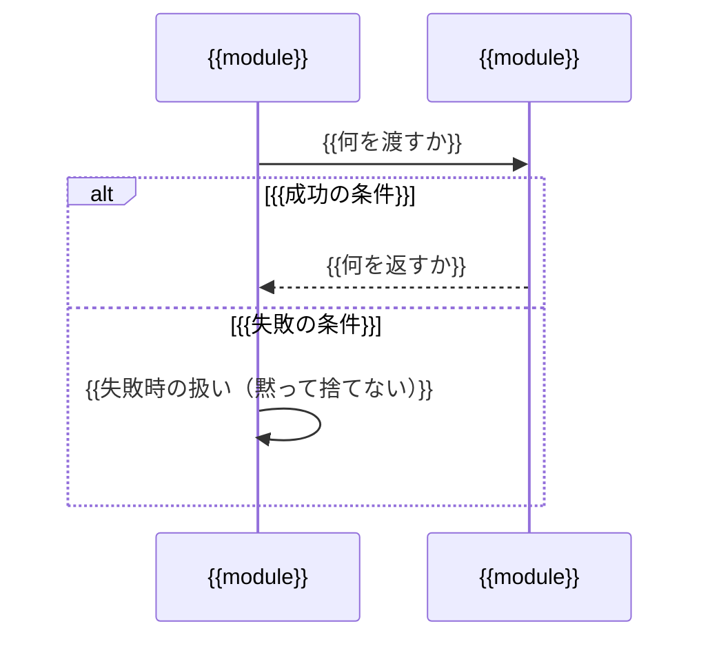

# 基本設計書テンプレート

`{{ }}` を埋めて使う。**該当しない節は消す**（無理に埋めない。ただし「モジュール構成」「依存の向き」「データフロー」「残課題」は消さない）。
`<!-- -->` の注釈コメントは**そのまま残す**。
節の番号は、消した節があれば詰めて振り直す（アンカーリンクも合わせて直す）。

---

# {{アプリ名}} 基本設計

## 1. 目的と設計方針
<!-- 何のためのシステムか。判断に迷ったときに何を優先するか -->
{{要件の目的を1〜2文で}}（→ [README](../README.md)）。
{{記録・入力の入口と、それぞれの役割を1〜2文で}}

設計上の判断に迷ったときは、次の順で優先する。

1. **{{観点}}**: {{言い切り。要件に判断基準があればそれを最優先にする}}
2. **{{観点}}**: {{言い切り}}
3. **{{観点}}**: {{言い切り}}

## 2. 決定事項
<!-- 要件で未決定だった論点と、その決定。理由はADRに書き、ここでは繰り返さない -->
| 論点       | 決定       | 記録                                        |
| ---------- | ---------- | ------------------------------------------- |
| {{論点}}   | {{決定}}   | [ADR-{{000N}}](./adr/{{000N}}-{{name}}.md)  |
| {{論点}}   | {{決定}}   | {{ADRが無い場合は出典。例: 既存スキルの前提}} |

## 3. システム構成
<!-- 利用者・外部サービス・自分たちの部品と、その間のやり取り -->
```mermaid
flowchart LR
    subgraph EXT["外部サービス"]
        {{X}}["{{外部サービス}}"]
    end

    subgraph SV["{{サーバー名}}"]
        {{A}}["{{部品}}<br/>{{module}}"]
        DB[("{{保存先}}")]
    end

    {{USER}}["{{利用者の端末}}"]

    {{A}} -->|"{{やり取り}}"| {{X}}
    {{A}} --> DB
```

- {{プロセスの数と、何を同居させるか。その理由}}
- {{書き込み元がいくつあるか／端末がどこまで直接やり取りするか}}

### 採用予定のライブラリ
<!-- 用途ごとに1つ。決まっていないものは残課題に回す -->
| 用途       | ライブラリ     |
| ---------- | -------------- |
| {{用途}}   | {{ライブラリ}} |

## 4. 処理の流れ
<!-- 要件の使い方の場面ごとに1節。登場するモジュールはモジュール構成にあるものだけ -->

### 4.1 {{場面}}



- {{図から読み取れない決めごと。対象の絞り込み、なぜその方式か}}

### 4.{{N}} 通知
<!-- 通知がある場合のみ。いつ・何を送るか -->
| 通知       | いつ       | 内容       |
| ---------- | ---------- | ---------- |
| {{通知}}   | {{時刻・契機}} | {{内容}} |

- {{要件と違う形にした場合は、その理由と残課題の ID}}
- {{同じ通知を何度送るか／送らない条件}}

## 5. モジュール構成
<!-- 各モジュールの責務を1文で。generate-module-design が「背景・目的」の出発点として読む -->
パッケージ名は `{{package}}`。各モジュールの責務は次の一文に限る。

| 層           | モジュール     | 責務                         |
| ------------ | -------------- | ---------------------------- |
| データ定義   | `model`        | モジュール間で受け渡すデータ構造の形だけを定義する |
| 純粋ロジック | `{{module}}`   | {{1文。「〜だけを行う」の形}} |
| 永続化       | `{{module}}`   | {{1文}}                      |
| サービス     | `{{module}}`   | {{1文}}                      |
| 外部接続     | `{{module}}`   | {{1文}}                      |
| 起動         | `{{module}}`   | {{1文}}                      |

<!-- 層は依存の向きと同じ順（依存される側が上）に並べる -->

## 6. 依存の向き
<!-- どのモジュールがどのモジュールを呼ぶのか。generate-module-design が「依存関係」節の出典として読む -->
```mermaid
flowchart TD
    {{MAIN}}(["{{entry}}"]) --> {{A}}(["{{module}}"])
    {{A}} --> {{B}}(["{{module}}"])
```

- すべてのモジュールは {{`model` / `config`}} を参照してよい（図では省略）。
- **上から下への一方向だけ**。下の層は上の層を知らない（{{具体例}}）。
- 純粋ロジック（{{モジュールの列挙}}）は DB も外部サービスも呼ばない。単体テストの中心にする。
- 外部サービスを呼ぶのは {{モジュールの列挙}} だけ。サービス層のテストではこれらを差し替える。

## 7. データフロー
<!-- どの値をどこで確定させるか。要件の「記録する項目」はすべて載せる -->
どの値をどこで確定させるかを、ここで固定する。

| 値         | 確定させる場所 | 決め方                                   |
| ---------- | -------------- | ---------------------------------------- |
| {{値}}     | `{{module}}`   | {{決め方。単位・生の値か正規化した値か}} |

- {{全体に共通する約束。例: 金額は整数（円）で扱う}}
- {{例: 時刻はすべて JST で扱う}}
- {{重複をどこで・何のキーで防ぐか}}

## 8. {{〇〇}}の方針
<!-- 複数のモジュールにまたがる決めごとがある場合のみ置く。ほかの節からはアンカーリンクで参照する -->
→ [ADR-{{000N}}](./adr/{{000N}}-{{name}}.md)

| 状況       | {{結果}}   | {{結果}}   |
| ---------- | ---------- | ---------- |
| {{状況}}   | {{値}}     | {{値}}     |

- {{表から読み取れない決めごと。何をしないか}}

## 9. データモデル
<!-- 保存するデータの形。細かい型と不変条件はモジュール設計書で定める -->
{{保存先}}のテーブル。詳細な型と不変条件は `docs/module/model_design.md` と {{永続化モジュール}} の設計書で定める。

### {{table}}（{{日本語名}}）

| 列         | 型       | 必須 | 内容     |
| ---------- | -------- | ---- | -------- |
| `{{col}}`  | {{type}} | 〇   | {{内容}} |

<!-- 必須は 〇、値が無いことがあるものは - -->

- {{不変条件。例: 「status が confirmed なら category_id は必ず入っている」}}
- {{削除・更新の扱い}}

### その他のテーブル

| テーブル     | 内容     |
| ------------ | -------- |
| `{{table}}`  | {{内容}} |

## 10. 外部インターフェース
<!-- 利用者や端末とのやり取りの形。細かい解釈はモジュール設計書で定める -->

### 10.1 {{入力の入口。例: Discord のメッセージ}}

| 送る内容   | 解釈     |
| ---------- | -------- |
| {{例}}     | {{解釈}} |

### 10.2 {{API}}

{{認証の方式}}

| メソッド | パス       | 内容     |
| -------- | ---------- | -------- |
| {{GET}}  | `{{path}}` | {{内容}} |

## 11. 非機能
<!-- 利用者数・権限・公開・秘密情報・障害時・ログ・バックアップ -->
| 観点       | 方針     |
| ---------- | -------- |
| {{観点}}   | {{方針。未決なら残課題の ID で参照する}} |

## 12. フォルダ構成
<!-- 後工程のスキルが前提にするフォルダ構成と揃える -->
```
{{リポジトリ名}}/
├── docs/
│   ├── design.md              … 本書（基本設計）
│   ├── adr/                   … 設計判断の記録
│   ├── module/                … モジュール設計書（{module}_design.md）
│   └── test/
│       └── ut-test-design.csv … 単体テスト設計書
├── {{package}}/               … {{実装}}
└── tests/
    └── {{package}}/           … test__{module}.py
```

## 13. 残課題
<!-- 本書で決めきれなかった論点。後工程のスキルはここに勝手に追記せず、報告する -->
<!-- ID は振り直さない。解決したものは行を消さず、補足に「解決: ADR-000N」と書く -->
| ID      | 論点       | 補足                                   |
| ------- | ---------- | -------------------------------------- |
| R-{{1}} | {{論点}}   | {{候補・本書での仮の扱い・決める条件}} |
