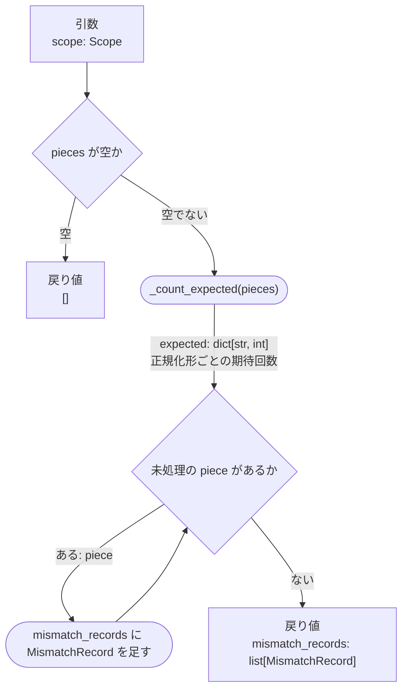

# モジュール設計書作成スキル

`docs/module/{module}_design.md` を、**テンプレートの構成**で、**既存の設計書と同じ粒度**で書き起こすスキルです。

このスキルがやるのは「**入力（基本設計・ADR・関連設計書）を読む → 構成を決める → 設計書を書く → 自己点検して報告**」まで。
**実装コード（プロダクトコード）は書きません。** 設計判断が決まっていない箇所を推測で埋めることもしません（→ 「やらないこと」）。

## 前提とするフォルダ構成

対象フォルダ（ユーザーが指定する。例: `development/.../381_変換内容の欠落を保証する方針を定める`）配下:

```
{対象フォルダ}/
├── docs/
│   ├── design.md                    … 基本設計（モジュール構成・依存の向き・データフローの出典）
│   ├── adr/
│   │   └── 000N-*.md                … 設計判断の記録（「なぜそうするか」の出典）
│   ├── module/
│   │   └── {module}_design.md       … ★このスキルの生成先
│   └── test/
│       └── ut-test-design.csv       … 単体テスト設計書（この設計書を読んで後工程で作られる）
└── {package}/                       … 実装先（このスキルでは触らない）
```

**この設計書は `generate-ut-test` スキルの入力になる。** 単体テスト設計書とテストコードは
ここに書かれたシグネチャ・フロー・境界条件を根拠に作られるため、
「期待値が一意に決まる」粒度まで書くことがこの設計書の合格ラインになる。

## 設計書の2つの型

対象モジュールがどちらかを最初に決める。混ぜない。

| 型                     | 例                                 | 中心となる節                              |
| ---------------------- | ---------------------------------- | ----------------------------------------- |
| 関数モジュール型       | `normalize` / `output` / `extract` | `## 関数一覧` / `## 関数詳細`             |
| データ定義モジュール型 | `model`                            | `## データ構造一覧` / `## データ構造詳細` |

骨子はテンプレートを使う。

- 関数モジュール型: `templates/function_module.md`
- データ定義モジュール型: `templates/data_module.md`

## 進め方

### Step1. 対象を確定する

1. 対象フォルダと**対象モジュール名**を確定する。**推測で決めない。曖昧なら確認する。**
2. `docs/module/{module}_design.md` が既にあるか確認する。
   - **空ファイル（0バイト）で置かれていることが多い。** これは「これから書く」印なので、そのまま書いてよい。
   - 中身がある場合は**上書き前に必ず読み**、手で書かれた記述を落とさないようにする。
     全面的に書き直すかどうかはユーザーに確認する。
3. 同じ `docs/module/` にある**既存の設計書（中身のあるもの）を1〜2本読む**。

### Step2. 入力を読む

書き始める前に、少なくとも次を読む。読まずに書かない。

| 入力                            | そこから取るもの                                                     |
| ------------------------------- | -------------------------------------------------------------------- |
| `docs/design.md` モジュール構成 | そのモジュールの**責務の一文**。設計書の「背景・目的」の出発点になる |
| `docs/design.md` 依存の向き     | 「依存関係」節に書く依存先と、**呼ばれる側／呼ぶ側の関係**           |
| `docs/design.md` データフロー   | 抽出単位・どこで値を確定させるかなど、モジュールをまたぐ前提         |
| `docs/adr/*.md`                 | 「なぜそう決めたか」。詳細の記述で参照する                           |
| `docs/module/model_design.md`   | 受け渡すデータ構造のフィールドと**不変条件**。これを満たすように書く |
| 隣接モジュールの設計書          | 責務の境界（何を「しない」か）。重複や矛盾を作らないため             |
| 既存の実装（あれば）            | 実際のシグネチャ。設計書と食い違う場合は**書き換えず報告する**       |

### Step3. 骨子を先に固める

いきなり関数詳細から書かない。次の順で確定させる。

1. **背景・目的**: なぜこのモジュールが要るのか。`design.md` の責務の一文を、
   「何が困るのか → だからこうする」の形にほどく。最後に**責務の範囲**を1文で言い切る
   （例: 「何が落ちているかの判断は行わず、取り出すことだけを責務とする」）。
2. **関数一覧**（またはデータ構造一覧）: 先に全関数を出し切る。
   - 列は `関数名（呼び出し階層）| 引数 | 戻り値 | 概要`。階層が無いモジュールは `関数名`。
   - **並び順は呼び出し階層順**（入口の関数が先頭、以下呼ばれる順）。
   - 公開関数以外は `_` 始まりにする。入口となる公開関数が1つに絞れているか確認する。
   - 引数は `名前: 型` をカンマ区切りで書く。戻り値は型だけ書く。
3. **関数間の依存**（関数が3つ以上ある場合）: `flowchart LR` で呼び出し関係だけを描く。
   系統が2つに分かれるなど図から読み取れない事情があれば、図の直後に1〜2文で補う。
4. **依存関係**: `モジュール | 用途` の表。標準ライブラリは用途に「（標準ライブラリ）」と添える。
   表の後に散文で次を書く。**ここが責務の境界の宣言になる。**
   - 誰から呼ばれるか（例: 「本モジュールは `main` から呼ばれる」）
   - **何を知らない／何を呼ばないか**（例: 「突合も出力も知らない」「`drop_enumerator` は呼ばない」）
   - `design.md` と食い違う点があれば、引用ブロック（`>`）で理由付きで明示する
5. **モジュール冒頭に置く定数**（将来変わりうる値がある場合のみ）:
   `定数 | 内容 | 変わる条件` の表。共通の定数モジュールには集めない。
6. **方針の節**（必要なモジュールのみ）: 「何をどの単位で取り出すか」のように、
   複数の関数にまたがる決めごとは `## 〇〇の方針` として独立させ、
   各関数の詳細からはアンカーリンク（`[図の数え方](#図の数え方)`）で参照する。同じ説明を二度書かない。

### Step4. 関数詳細を書く

関数ごとに、**次の項目を必ずこの順で**書く（`フロー図` のみ任意）。

- `- シグネチャ`: python のコードフェンスで `def` 行1行だけ。本体は書かない。
- `- 引数一覧`: `引数名 | 型 | 必須 | 内容`。必須は `〇`、任意は `-`。
- `- 返り値一覧`: `型 | 内容`。
- `- 概要`: 散文。**処理の流れを自然言語で**短く書く（→ 下記）。
- `- 詳細`: 散文。**何をするか＋なぜそうするか**を書く（→ 下記）。
- `- 制約`: 番号付き箇条書き。**その関数が守るべきこと／してはいけないこと**を書く（→ 下記）。
- `- フロー図`: mermaid（→ Step5）。分岐やループが無い関数には付けない。
- `- フロー`: 番号付きの手順。

見出しは `### {関数名}関数`。**シグネチャの名前と揃える**（`_` 始まりなら見出しも `_` 付き）。

#### 本文での関数名・変数名の書き方

**本文は「何をするか」を自然言語で書き、関数名・変数名は「どこで行われるか／何を指すか」の補足として括弧で添える。**
関数名や変数名を文の主語・目的語にしない。

| 避ける書き方                               | 書く形                                                         |
| ------------------------------------------ | -------------------------------------------------------------- |
| `_extract_links()`でリンクを抽出する       | 本文中のリンクを抽出する（`_extract_links()`）                 |
| `links`のうち`_is_figure_host()`が真のもの | 抽出済みのリンク（`links`）のうち図ホストを指すもの            |
| `normalize()`は改行を含む空白を除去する    | 正規化では改行を含む空白を除去する（`normalize()`）            |
| `side`に`md`、`line`に行番号を入れる       | Markdown側であること（`side`: `md`）、行番号（`line`）を入れる |

- 関数を添えるときは `関数名()` と書き、変数・引数・フィールド（`links` など）と見分けられるようにする。引数は書かない。
- 他モジュールの関数も同じ（「行の種別を決める（`normalize.classify_fence_lines()`）」）。
- モジュール名には `()` を付けない。役割を言葉で添える（「突合側（`matcher`）」「`normalize`モジュール」）。
- 同じ段落で2回目以降に出るときは、括弧の補足を省いて自然言語だけにしてよい。
- 他の設計書への参照（`` [matcher_design.md](./matcher_design.md) `_match_hyperlinks()` ``）は参照先を示すものなので、この形のままでよい。
- 設計書全体（背景・目的、依存関係、方針の節、概要・詳細・フロー、表の中の説明）に適用する。
  見出し（`### {関数名}関数`）、シグネチャ、関数一覧の「関数名」列、mermaid 図は対象外とする。

#### 「概要」に書くこと

概要は**関数の処理の流れを、先に文章でつかむための場所**。詳細やフローを読む前に、全体像が分かるようにする。

- 2〜4文程度で、処理を**行う順に**書く（「まず〜する。次に〜する。最後に〜して返す。」）。
- 何を受け取り、どう加工し、何を返すかが一読で分かるようにする。
- 記号や内部の変数名に頼らず、自然言語で書く。関数名・記法（`` など）は必要な範囲で使ってよい。
- 根拠（なぜそうするか）や境界・異常のケースは書かない。それぞれ「詳細」「フロー」に書く。
- **「フロー」の手順を要約したものにする。** フローに無い処理を書かない（食い違いを作らない）。

#### 「詳細」に書くこと

詳細は**判断の根拠を残す場所**で、フローの言い換えではない。次のうち当てはまるものを書く。

- なぜこの単位・この方法なのか（例: 「セル全体を1片にすると何が落ちたか分からなくなるため分割する」）
- 入出力の性質（**決定的・冪等・順序保持**など。後工程のテストの根拠になる）
- 前提とする入力の状態（例: 「入力は `normalize` 済みであることを前提とする」）
- 他モジュールとの責務の線引き（例: 「判定は `matcher` が行う。ここでは落とさない」）
- 基本設計・`model_design.md` の不変条件への参照

#### 「制約」に書くこと

制約は**実装がその関数で守らなければならない決まりを、一覧で確認できる場所**。
詳細に散文で書いた根拠のうち、守るべきこと・してはいけないことを1項目1文の箇条書きに言い切る。
根拠（なぜそうするか）は詳細に書き、制約では繰り返さない。

- 入出力の性質（決定的、入力の順を保つ、入力と同じ長さを返す、引数を変更しない など）
- 処理の順序の制約（「記法の除去は正規化より先に行う」など）
- 扱う範囲の限定（「本文の行からだけ拾う」「探す位置は2箇所に限る」など）
- 責務の境界として**やらないこと**（「内容が落ちているかの判断は行わない（突合側の`matcher`が行う）」など）
- 値の持ち方（「リンク先は正規化せず生の文字列のまま持つ」「定数は関数の中に直接書かず、モジュール冒頭の定数から参照する」など）
- 異常時の扱い（「例外を送出し、握りつぶさない」「無いことは指摘せず空文字を返す」など）

書き方の決まり
- 「〜する」「〜しない」と言い切る。「〜が望ましい」のようなぼかした書き方はしない。
- **詳細・フロー・方針の節に書かれていることから導く。** 制約にだけ書かれた新しい決めごとを作らない。
  導いた結果、既存の記述に無い具体例（`notfigma.com`は偽 など）を足した場合は、報告で要確認に挙げる。
- 1項目に1つの制約を書く。後工程のテスト観点として、1項目ずつ確かめられる粒度にする。
- 当てはまるものが無い関数でも項目は消さず、入出力の性質など最低1つは書く。
- **番号付き箇条書き（`1.` `2.` …）にし、番号は関数ごとに1から振る。**
  番号は単体テスト設計書（`ut-test-design.csv`）の `constraint_id` 列から「その行の関数の制約の番号」として参照される。
- 制約にテストIDは書かない。制約とテストの対応は CSV の `constraint_id` 列だけで持つ（二重に持たない）。
- 既存の設計書の制約を直すときは、**既存の番号を振り直さない**。追加は末尾に次の番号で足し、
  削除した番号は欠番のまま残す（CSV の `constraint_id` が別の制約を指してしまうため）。
  振り直しが必要な場合は、CSV の `constraint_id` の更新が要ることを報告する。

#### 「フロー」に書くこと

- **処理の順に番号を振る。** 番号は後段の説明（「手順3の対応表」）から参照できる単位で切る。
- 順序に依存関係がある場合は、フローの後に**「順序の理由」**として
  `手順A→B: 〜のため` の形で列挙する。順序が仕様の一部になるため。
- **境界・異常のケースを最後の番号として必ず書く。** 書き漏らすと後工程のテストが作れない。
  - 空入力のとき何を返すか（例外にするのか、空を返すのか）
  - 対象が見つからないとき、0件のとき、ゼロ除算になるとき
  - 除去・変換の対象外とする条件（「4桁以上は連番とみなさない」など）
- 一覧が長くなるもの（置換の対応表、除去対象の文字、識別子の一覧）は
  フローの後に**表として別立て**にし、フローからは「（→ 手順3の対応表）」で参照する。
- 実装の書き方（正規表現そのもの、ライブラリの呼び出し順）は書かない。**何をするかまで**にする。

### Step5. フロー図を書く（必要な関数のみ）

分岐・ループ・他関数の呼び出しがある関数だけに付ける。記法は既存設計書に揃える。



| 要素           | 書き方                             | 備考                                     |
| -------------- | ---------------------------------- | ---------------------------------------- |
| 入口           | `IN["引数<br/>名前: 型"]`          | 引数が複数なら `<br/>` で並べる          |
| 出口           | `OUT["戻り値<br/>名前: 型"]`       | 早期リターンも別ノードとして出す         |
| 判断           | `{"〜か"}`                         | 分岐ラベルに結果（「ある」「空」）を書く |
| 処理・関数呼出 | `(["_fn(引数)"])`                  | 呼ぶ関数は実際の関数名で書く             |
| ループ         | `{"未処理の X があるか"}`          | `ある: x` と `ない` の2本の辺を出す      |
| 値の受け渡し   | 辺のラベルに `"名前: 型<br/>意味"` | 中間の値が何かを図だけで追えるようにする |

### Step6. 自己点検する

書き終えたら、**書いた設計書を読み直して**次を確認する。1つでも欠けていたら直してから報告する。

- [ ] 見出し構成がテンプレートと一致している
- [ ] 各節の `<!-- なんのために必要なのか -->` などの**注釈コメントを残している**
- [ ] 関数一覧の関数が、関数詳細に**すべて**書かれている（逆も同様。過不足なし）
- [ ] 関数一覧のシグネチャと、各関数詳細のシグネチャが**一字一句一致**している
- [ ] 引数一覧・返り値一覧が、シグネチャの引数名・型と一致している
- [ ] 「関数間の依存」図に出てくる関数と、関数一覧が一致している
- [ ] 依存関係の表に無いモジュールを、フローや詳細で使っていない
- [ ] 本文が自然言語で書かれ、関数名・変数名が**文の主語・目的語になっていない**（括弧の補足になっている）
- [ ] 補足として添えた関数が `関数名()` になっている（モジュール名・変数名には付けていない）
- [ ] 各関数に**概要**があり、「フロー」の手順と食い違っていない
- [ ] 各関数に**制約**があり、詳細・フロー・方針の節と食い違っていない（制約にだけある決めごとが無い）
- [ ] 各関数のフローに**境界・異常のケース**が書かれている
- [ ] `model_design.md` のデータ構造を使う箇所が、その**不変条件と矛盾していない**
- [ ] 他ファイルへのリンクが相対パスで、**実在するファイル**を指している
- [ ] 実装コード（`def` 行と dataclass 定義を除く）が入っていない
- [ ] 表がパイプ区切りで整形されており、列数が揃っている

### Step7. 報告する

- 生成したファイルのパスと、書いた関数（データ構造）の数
- **要確認リスト**: 入力から一意に決まらず、こちらで置いた仮定（→ 下記「決まっていないことの扱い」）
- 入力側の不備（`design.md` と実装の食い違い、参照先ADRの不在、隣接設計書との矛盾）
- 次にやるとよいこと（例: この設計書をもとに `ut-test-design.csv` を書く）

## 決まっていないことの扱い

設計書を書いていると、基本設計にもADRにも答えが無い論点が必ず出る。**推測で断定しない。**

| 状況                                             | 扱い                                                                       |
| ------------------------------------------------ | -------------------------------------------------------------------------- |
| 他の設計書・ADRから一意に導ける                  | 導いて書く。根拠のリンクを本文に置く                                       |
| 妥当な選択肢が複数あり、どれでも後段が破綻しない | 1つ選んで書き、**選んだ理由を「詳細」に書く**。報告で要確認に挙げる        |
| 決め方次第で他モジュールの仕様が変わる           | 書かずに**ユーザーに確認する**。仮で埋めない                               |
| 本筋ではないが未決の論点                         | 基本設計の「残課題」に挙げるべき事項として**報告する**（勝手に追記しない） |

## やらないこと

- **実装コードを書くこと。** シグネチャ（`def` 行）と dataclass の定義までに留める。
- **設計判断の捏造。** ADRや基本設計に根拠が無い決めごとを、あるかのように書かない。
- **`docs/design.md` や ADR の書き換え。** 食い違いを見つけたら報告するだけにする
  （ユーザーが直すと判断した場合のみ、依頼を受けてから直す）。
- **実装に合わせて設計書を書くこと。** 既存実装と基本設計が食い違う場合、実装を正として
  黙って書き写さない。食い違いとして報告する。
- **他モジュールの責務の取り込み。** 「ついでにここでやる」で境界を動かさない。
  必要だと考えるなら、設計書に書く前に提案する。
- **既存設計書の書式を変えること。** 表記ゆれを見つけても、対象モジュールの設計書だけを
  勝手に別書式にしない。既存に合わせ、気づいた点は報告する。
