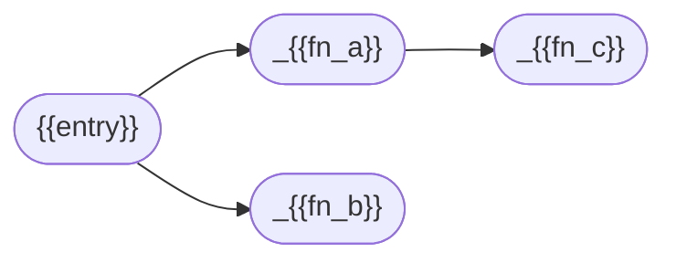
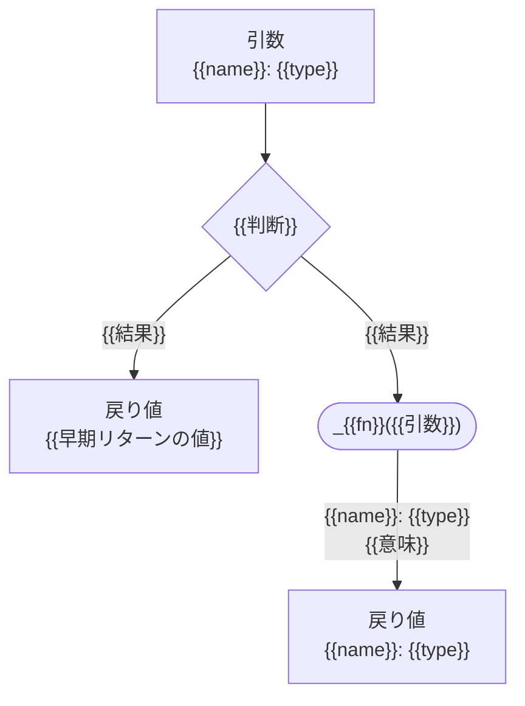

# 関数モジュール型テンプレート

`{{ }}` を埋めて使う。**該当しない節は消す**（無理に埋めない）。
`<!-- -->` の注釈コメントは**そのまま残す**。
本文は自然言語で書き、関数名・変数名は補足として括弧で添える（例: 「本文中のリンクを抽出する（`_extract_links()`）」）。
関数を添えるときは `関数名()` と書く（見出し・シグネチャ・関数一覧の「関数名」列・mermaid 図は除く）。

---

# {{module}}.py

## 背景・目的
<!-- なんのために必要なのか -->
{{何が起きるのか／何が困るのか。2〜4文}}
{{だからこのモジュールで何をするのか}}
{{責務の範囲を1文で言い切る。例: 「判断は行わず、取り出すことだけを責務とする」}}

## 関数一覧
<!-- どのような関数があるのか -->
| 関数名（呼び出し階層） | 引数                      | 戻り値      | 概要             |
| ---------------------- | ------------------------- | ----------- | ---------------- |
| `{{fn}}`               | {{name}}: {{type}}        | {{type}}    | {{1行の概要}}    |
| `_{{fn}}`              | {{name}}: {{type}}        | {{type}}    | {{1行の概要}}    |

<!-- 並び順は呼び出し階層順（入口 → 呼ばれる順）。階層が無いモジュールは列名を「関数名」にする -->

### 関数間の依存
<!-- どの関数がどの関数を呼ぶのか -->
<!-- 関数が3つ以上ある場合に置く -->


{{図から読み取れない事情があれば1〜2文で補う。例: 「図の抽出はブック単位で1度だけ行い、
シート単位の抽出とは別の系統になる」}}


## 依存関係
<!-- なんのモジュールに依存しているのか -->
| モジュール   | 用途                                   |
| ------------ | -------------------------------------- |
| `{{module}}` | {{何にどう使うか}}                     |
| `{{stdlib}}` | {{用途}}（標準ライブラリ）             |

{{誰から呼ばれるか。例: 「本モジュールは `main` から呼ばれる」}}
{{何を知らない／何を呼ばないか。責務の境界をここで宣言する}}

<!-- design.md と食い違う点があれば引用ブロックで理由付きに残す -->
> {{design.md の記述との差分と、その理由}}


### モジュール冒頭に置く定数
<!-- 将来変わりうる値 -->
<!-- 該当する値がある場合のみ置く -->
| 定数          | 内容       | 変わる条件     |
| ------------- | ---------- | -------------- |
| `{{CONST}}`   | {{内容}}   | {{変わる条件}} |


## {{〇〇}}の方針
<!-- 何をどの単位で取り出すのか／どう扱うのか -->
<!-- 複数の関数にまたがる決めごとがある場合のみ置く。各関数の詳細からはアンカーリンクで参照する -->
| 対象       | {{扱い}}   |
| ---------- | ---------- |
| {{対象}}   | {{扱い方}} |

{{この方針の結果、何が起きるか／何を人に回すか}}


## 関数詳細
<!-- 各関数はどのようなフローで処理を行うのか -->

### {{fn}}関数
- シグネチャ
```python
def {{fn}}({{name}}: {{type}}) -> {{type}}
```

- 引数一覧

| 引数名     | 型       | 必須 | 内容     |
| ---------- | -------- | ---- | -------- |
| {{name}}   | {{type}} | 〇   | {{内容}} |

- 返り値一覧

| 型       | 内容     |
| -------- | -------- |
| {{type}} | {{内容}} |

- 概要
{{処理の流れを行う順に2〜4文の自然言語で。例: 「まず〜する。次に〜する。最後に〜して返す。」}}
{{根拠や境界のケースは書かない（詳細・フローに書く）}}

- 詳細
{{何をするか}}
{{なぜその単位・その方法なのか（根拠）}}
{{入出力の性質（決定的・冪等・順序保持）／前提とする入力の状態}}
{{他モジュールとの責務の線引き。参照は [model_design.md](./model_design.md) のように相対リンクで}}

- 制約
<!-- 守るべきこと／してはいけないことを1項目1文で言い切る。根拠は詳細に書き、ここでは繰り返さない -->
<!-- 番号は関数ごとに1から振る。ut-test-design.csv の constraint_id 列から参照されるため、既存の番号は振り直さない -->
  1. {{入出力の性質。例: 「同じ入力からは常に同じ結果を返す（決定的）」}}
  2. {{順序・範囲の限定。例: 「本文の行からだけ拾う」}}
  3. {{やらないこと。例: 「内容が落ちているかの判断は行わない（突合側の`matcher`が行う）」}}

- フロー図
<!-- 分岐・ループ・他関数の呼び出しがある関数だけに置く -->


- フロー
1. {{手順}}
2. {{手順}}
3. {{境界・異常のケース（空入力・0件・見つからない場合に何を返すか）を必ず書く}}

<!-- 順序が仕様の一部になる場合だけ置く -->
順序の理由
- 手順{{A}}→{{B}}: {{先にやらないと何が壊れるのか}}

<!-- 一覧が長いものはフローの後に表として別立てにする -->
{{対応表の名前}}（手順{{N}}）
| {{列}}   | {{列}}   | 備考     |
| -------- | -------- | -------- |
| {{値}}   | {{値}}   | {{理由}} |
