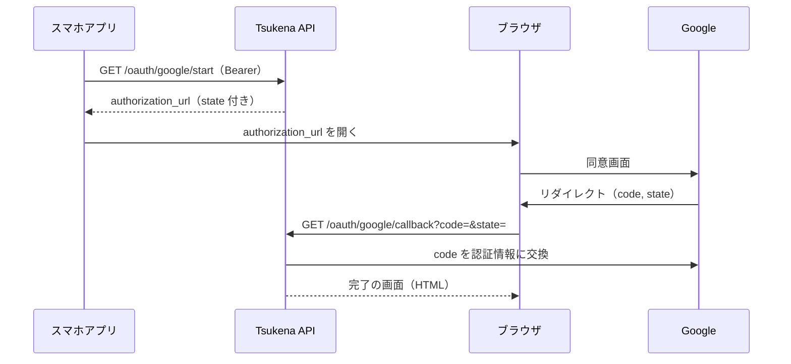

# Tsukena API 一覧

スマホアプリ（`app/`）がサーバーの REST API（`tsukena/api`）を呼ぶときの約束を定める。
エンドポイントの一覧は [design.md 10.2](./design.md#102-rest-apiスマホアプリ向け) が元であり、本書はそれぞれの入力・出力・副作用・エラーを決める。
項目の名前と意味は [model_design.md](./module/model_design.md) の構造に揃える。

## 1. 共通の約束

### 1.1 通信と認証

| 項目         | 約束                                                                 |
| ------------ | -------------------------------------------------------------------- |
| ベース URL   | 経路が決まるまで未定（→ [design.md 残課題 R-1](./design.md#13-残課題)）。アプリは `core/` から受け取る |
| 認証         | `Authorization: Bearer {トークン}`。トークンはスマホアプリ用と bot 用の2つをサーバーの設定に持つ（→ [1.5](#15-トークンの種類)）。例外は `/`（→ [2.9](#29-サーバーの説明)）と `/oauth/google/callback`（→ [2.7](#27-gmail-連携)） |
| 形式         | リクエストとレスポンスの本文は JSON（`Content-Type: application/json`、UTF-8） |
| 利用者       | 1人。ユーザーを区別する引数は持たない                                 |

### 1.2 値の表し方

| 値       | JSON での表し方                                      | 例                            |
| -------- | ---------------------------------------------------- | ----------------------------- |
| 金額     | 円単位の整数（number）。小数は受け付けない           | `800`                         |
| 日付     | `YYYY-MM-DD` の文字列（JST）                          | `"2026-10-15"`                |
| 時刻     | `HH:MM` の文字列（JST）。分からなければ `null`         | `"12:30"`                     |
| 日時     | ISO 8601 のタイムゾーン付き文字列（`+09:00`）          | `"2026-10-15T12:30:00+09:00"` |
| 月       | `YYYY-MM` の文字列                                   | `"2026-10"`                   |
| 状態     | `confirmed` / `pending`                              |                               |
| 入口     | `gmail` / `discord`                                  |                               |

- 値が無いことを `null` で表すのは、model の必須が「-」の項目だけとする。文字列の値が無いときは空文字を返す（`merchant`、`memo` など）。
- 部分的な修正（`PATCH`）では、**送らなかった項目は変えない**。`null` を送って値を消す操作は、どの項目にも無い。

### 1.3 エラー

エラーの本文は FastAPI の既定の形（`{"detail": ...}`）とする。

| ステータス | いつ                                                                 |
| ---------- | -------------------------------------------------------------------- |
| 400        | 本文の形は正しいが、値の組み合わせが成り立たない（例: 支払日が利用日より前） |
| 401        | トークンが無い、または一致しない                                     |
| 403        | トークンは正しいが、そのトークンでは呼べないエンドポイントである（→ [1.5](#15-トークンの種類)） |
| 404        | パスの ID の記録・収入・カテゴリが存在しない                         |
| 409        | 一意制約に反する（カテゴリの名前・絵文字の重複）                     |
| 422        | 本文・クエリの形が正しくない（型の違い、金額が0以下、存在しないカテゴリの ID、空の名前など） |

### 1.4 共通で使う JSON の形

#### Transaction（支出の記録）

model の `Transaction` から、照合キー（`merchant_key`）と重複排除キー（`source_ref`）を除いたもの。どちらもサーバーの内部でだけ使う。

```json
{
  "id": 12,
  "occurred_date": "2026-10-14",
  "occurred_time": "12:30",
  "paid_date": "2026-11-27",
  "amount": 800,
  "merchant": "スターバックス",
  "memo": "",
  "category_id": 1,
  "status": "confirmed",
  "payment_method": "楽天カード",
  "source": "gmail",
  "created_at": "2026-10-14T12:35:02+09:00",
  "updated_at": "2026-10-14T12:35:02+09:00"
}
```

#### Income（収入）

```json
{
  "id": 3,
  "received_date": "2026-10-25",
  "amount": 250000,
  "memo": "給与",
  "created_at": "2026-10-25T20:01:00+09:00",
  "updated_at": "2026-10-25T20:01:00+09:00"
}
```

#### Category（カテゴリ）

```json
{ "id": 1, "name": "食費", "emoji": "🍚", "sort_order": 1 }
```

### 1.5 トークンの種類

→ [ADR-0007](./adr/0007-bot-accesses-data-through-api.md)

| トークン       | 使う側                         | 呼べるエンドポイント（[2](#2-エンドポイント一覧) の番号） |
| -------------- | ------------------------------ | -------------------------------------------------------- |
| アプリ用       | スマホアプリ（`app/`）          | 1〜15、18、19                                            |
| bot 用         | Discord bot（`tsukena/bot/`）   | 2、3、9、17                                              |

- 現金の記録（17）は bot 用のトークンでしか呼べない。アプリ用のトークンで呼ぶと `403` を返す。スマホアプリから支出を追加できない方針（→ [design.md 4.3](./design.md#43-スマホアプリ修正確認待ち振り返り収入)）を、API の側で守るためである。
- bot 用のトークンで、上の表にないエンドポイントを呼ぶと `403` を返す。bot が使うのは、記録・リアクションから記録を探すこと・カテゴリの変更・カテゴリの一覧だけだからである。
- どちらのトークンでもないときは `401` を返す。
- 2つのトークンは環境変数で渡す。値は別々にし、同じ値を設定しない。

## 2. エンドポイント一覧

| #  | メソッド | パス                          | 内容                                   | 使う feature     |
| -- | -------- | ----------------------------- | -------------------------------------- | ---------------- |
| 1  | GET      | `/months/{month}/summary`     | 月の集計                               | `month_summary`  |
| 2  | GET      | `/transactions`               | 支出の記録の一覧                       | `expense`        |
| 3  | PATCH    | `/transactions/{id}`          | 支出の記録の修正・確認待ちの分類       | `expense`        |
| 4  | DELETE   | `/transactions/{id}`          | 支出の記録の削除                       | `expense`        |
| 5  | GET      | `/incomes`                    | 収入の一覧                             | `income`         |
| 6  | POST     | `/incomes`                    | 収入の追加                             | `income`         |
| 7  | PATCH    | `/incomes/{id}`               | 収入の修正                             | `income`         |
| 8  | DELETE   | `/incomes/{id}`               | 収入の削除                             | `income`         |
| 9  | GET      | `/categories`                 | カテゴリの一覧                         | `category`       |
| 10 | POST     | `/categories`                 | カテゴリの追加                         | `category`       |
| 11 | PATCH    | `/categories/{id}`            | カテゴリの名前・絵文字・表示順の変更   | `category`       |
| 12 | GET      | `/budget`                     | 月の予算の取得                         | `budget`         |
| 13 | PUT      | `/budget`                     | 月の予算の変更                         | `budget`         |
| 14 | GET      | `/import-failures`            | 取り込めなかったメールの一覧           | `import_failure` |
| 15 | GET      | `/oauth/google/start`         | Gmail 連携の開始                       | `gmail_link`     |
| 16 | GET      | `/oauth/google/callback`      | Gmail 連携の完了（Google から呼ばれる） | なし             |
| 17 | POST     | `/cash-records`               | 現金の記録（bot 用のトークンだけ）     | なし（bot が使う） |
| 18 | DELETE   | `/import-failures/{message_id}` | 取り込めなかったメールの記録を消す   | `import_failure` |
| 19 | POST     | `/import-failures/{message_id}/retry` | 取り込めなかったメールをその場で取り込み直す | `import_failure` |
| 20 | GET      | `/`                           | サーバーの説明（HTML）                 | なし             |

スマホアプリから支出の記録を追加するエンドポイントは作らない。現金は Discord から、カード・QR決済は自動で入るため、アプリから追加できると二重登録が起きうる（→ [design.md 4.3](./design.md#43-スマホアプリ修正確認待ち振り返り収入)）。
Discord から送られた現金の記録（17）は、bot 用のトークンでしか呼べないエンドポイントとして持つ（→ [1.5](#15-トークンの種類)）。
カテゴリを削除するエンドポイントも作らない。過去の記録と分類ルールがカテゴリを参照しているためである。

### 2.1 月の集計

#### GET `/months/{month}/summary`

| 引数    | 場所 | 必須 | 内容                 |
| ------- | ---- | ---- | -------------------- |
| `month` | パス | 〇   | 対象の月（`YYYY-MM`） |

レスポンス `200`（model の `MonthlySummary`）

```json
{
  "month": "2026-10",
  "income_total": 250000,
  "total": 78300,
  "balance": 171700,
  "budget": 80000,
  "remaining": 1700,
  "by_category": [
    { "category": { "id": 1, "name": "食費", "emoji": "🍚", "sort_order": 1 }, "amount": 32100 },
    { "category": null, "amount": 1280 }
  ]
}
```

- 支出は**支払日**、収入は**入金日**がその月に属するものを数える（→ [ADR-0004](./adr/0004-monthly-totals-by-paid-date.md)）。
- `by_category` の `category` が `null` の要素は、カテゴリが未設定（確認待ち）の記録の合計である。並びは金額の多い順、同じ金額なら表示順、未分類は最後とする。
- 記録も収入も無い月でも `404` にせず、合計を0、`by_category` を空の配列で返す。来月以降の月も指定できる。
- `month` が `YYYY-MM` の形でなければ `422`。

### 2.2 支出の記録

#### GET `/transactions`

| 引数     | 場所   | 必須 | 内容                                                     |
| -------- | ------ | ---- | -------------------------------------------------------- |
| `month`  | クエリ | -    | 支払日の月（`YYYY-MM`）で絞り込む。省略すると全期間       |
| `status` | クエリ | -    | `confirmed` / `pending` で絞り込む。省略するとどちらも    |
| `source_ref` | クエリ | - | 重複排除キーが一致する記録だけに絞り込む。省略すると絞り込まない |

レスポンス `200`: `Transaction` の配列。

- 並びは利用日の新しい順、同じ日なら時刻の新しい順（時刻の無いものは後）、さらに ID の大きい順とする。
- 月の明細（`expense_list_page`）は `month` だけを、同じ画面の確認待ちのバナーとシートは `status=pending` だけを指定する。確認待ちは月をまたいで溜まるため、月で絞らずに出す。
- ページ分けはしない。利用者が1人で、1か月の記録は数百件に収まる見込みのためである。
- 複数の引数を指定したときは、すべてに当てはまる記録を返す。
- `source_ref` は、bot がリアクションの付いた返事から記録を探すときに使う（`source_ref=discord:{元のメッセージの ID}`）。重複排除キーは一意なので、結果は0件か1件になる。見つからなくても `404` にせず、空の配列を返す。

#### PATCH `/transactions/{id}`

リクエスト（model の `TransactionUpdate`。すべて省略可）

```json
{
  "occurred_date": "2026-10-13",
  "paid_date": "2026-11-27",
  "amount": 850,
  "merchant": "スタバ",
  "memo": "期間限定のフラペチーノ",
  "category_id": 1
}
```

レスポンス `200`: 修正後の `Transaction`。

修正の内容に応じて、サーバーは次の処理も行う。

| 送った項目                         | サーバーが行うこと                                                   |
| ---------------------------------- | -------------------------------------------------------------------- |
| `category_id`                      | 状態を確定（`confirmed`）にし、その記録の照合キーの分類ルールを作成または上書きする。照合キーが空文字ならルールは作らない |
| `merchant`                         | 照合キーを作り直す。分類ルールは引き直さず、カテゴリと状態は変えない |
| `memo`                             | メモだけを変える。分類には使わないので、照合キー・カテゴリ・状態は変えない。空文字を送ると消える |
| `occurred_date`（`paid_date` は送らない） | 支払日を支払い手段のルールから計算し直す                       |
| `paid_date`                        | 送った値をそのまま使う（`occurred_date` を一緒に送っても計算しない） |

- `merchant` と `category_id` を一緒に送ったときは、作り直した照合キーでルールを学習する。
- 修正後の支払日が利用日より前になるときは `400`。
- `category_id` に `null` を送って未設定に戻すことはできない（`422`）。確定の記録を確認待ちに戻す経路は持たない。
- 存在しないカテゴリの ID は `422`、存在しない記録は `404`。
- 何も送らない（`{}`）ときは何も変えず、今の `Transaction` を返す。

#### DELETE `/transactions/{id}`

レスポンス `204`（本文なし）。

- 物理削除する。その記録の重複排除キーを `deleted_refs` に残し、Gmail 由来の記録が次の取り込みで復活しないようにする。
- 存在しない記録は `404`。

### 2.3 収入

→ [ADR-0005](./adr/0005-income-manual-entry-from-app.md)

#### GET `/incomes`

| 引数    | 場所   | 必須 | 内容                                 |
| ------- | ------ | ---- | ------------------------------------ |
| `month` | クエリ | 〇   | 入金日の月（`YYYY-MM`）で絞り込む     |

レスポンス `200`: `Income` の配列。並びは入金日の新しい順、同じ日なら ID の大きい順。

- `month` を省略したときは `422`。収入の一覧（`income_list_page`）は常に月を指定して開くためである。

#### POST `/incomes`

リクエスト（model の `IncomeInput`）

| 項目            | 型      | 必須 | 内容                                        |
| --------------- | ------- | ---- | ------------------------------------------- |
| `received_date` | string  | 〇   | 入金日（`YYYY-MM-DD`）                       |
| `amount`        | integer | 〇   | 金額（円、1以上）                           |
| `memo`          | string  | -    | メモ。省略したときは空文字                  |

```json
{ "received_date": "2026-10-25", "amount": 250000, "memo": "給与" }
```

レスポンス `201`: 追加した `Income`。

- 同じ内容の収入を続けて送っても、別の収入として追加する。収入には重複排除キーが無いため、二度押しの防止はアプリの側で行う（→ [5. 残課題](#5-残課題) A-3）。

#### PATCH `/incomes/{id}`

リクエスト（model の `IncomeUpdate`。すべて省略可）: `received_date`、`amount`、`memo`。
メモを消すときは空文字を送る。

レスポンス `200`: 修正後の `Income`。存在しない収入は `404`。

#### DELETE `/incomes/{id}`

レスポンス `204`（本文なし）。物理削除する。存在しない収入は `404`。

### 2.4 カテゴリ

#### GET `/categories`

レスポンス `200`: `Category` の配列。並びは表示順の小さい順、同じなら ID の小さい順。

#### POST `/categories`

| 項目         | 型      | 必須 | 内容                                        |
| ------------ | ------- | ---- | ------------------------------------------- |
| `name`       | string  | 〇   | 名前（空文字不可）                          |
| `emoji`      | string  | 〇   | 絵文字（空文字不可）                        |
| `sort_order` | integer | -    | 表示順。省略したときは今ある最大値 + 1（末尾） |

レスポンス `201`: 追加した `Category`。

- 名前または絵文字が既存のカテゴリと重複するときは `409`。

#### PATCH `/categories/{id}`

リクエスト（model の `CategoryUpdate`。すべて省略可）: `name`、`emoji`、`sort_order`。

レスポンス `200`: 変更後の `Category`。

- 重複は `409`、空文字は `422`、存在しないカテゴリは `404`。
- 名前と絵文字を変えると、それ以降の Discord の返事とリアクションに反映される。過去に送った返事は書き換えない。

### 2.5 月の予算

#### GET `/budget`

レスポンス `200`

```json
{ "monthly_budget": 80000 }
```

#### PUT `/budget`

リクエスト: `{ "monthly_budget": 90000 }`（1以上の整数）。レスポンス `200`: 変更後の値（GET と同じ形）。

- 予算は全体で1つだけ持ち、月ごとには持たない。変更すると、過去の月を含むすべての月の集計がこの値で計算される（→ [5. 残課題](#5-残課題) A-2）。
- 変更しても予算の到達の通知は送らない。通知は記録した直後にだけ判定する（→ [design.md 4.4](./design.md#44-通知)）。

### 2.6 取り込めなかったメール

#### GET `/import-failures`

レスポンス `200`: 次の形の配列。並びは失敗した日時の新しい順。

```json
[
  {
    "message_id": "18c2f0a1b2c3d4e5",
    "sender": "楽天カード <info@mail.rakuten-card.co.jp>",
    "subject": "カード利用のお知らせ",
    "reason": "金額が見つかりません",
    "failed_at": "2026-10-14T08:15:00+09:00"
  }
]
```

- 本文は返さない（model の `ImportFailure` が本文を持たないため）。
#### DELETE `/import-failures/{message_id}`

失敗の記録を消す。そのメールは、次の取り込み（5分以内）で解析し直される。アプリの「取り込み直す」は、すぐに結果が分かる `POST /import-failures/{message_id}/retry` を使う。

レスポンス `204`。その `message_id` の記録が無ければ `404`。

- 定期の取り込みは直近7日分のメールしか問い合わせないため、それより前に届いたメールは、消しても取り込み直されない。一覧から消えるだけになる。
- 解析器を直していなければ、次の取り込みでまた失敗し、一覧に戻る（通知も再び届く）。

#### POST `/import-failures/{message_id}/retry`

取り込めなかったメールを、その場で取り込み直す。解析器を直した後に使う。

レスポンス `200`

```json
{ "recorded": 1 }
```

- `recorded` は、新しく記録した支払いの件数。重複・削除済みで記録しなかった支払いは数えない。
- メールを ID で Gmail から取り直すので、届いてからの日数によらず取り込み直せる。
- 失敗の記録を消すことと支払いの記録を、1つのトランザクションで行う。同じ時刻に定期の取り込みが動いても、同じメールを二重に記録しない。
- まだ解析できないときは、失敗の理由と日時を新しくして記録を残し、`422` を返す。`detail` に理由（例: `支払いが見つかりません`）を入れる。Discord への通知は送らない。

| ステータス | 意味 |
| ---------- | ---- |
| `404`      | その `message_id` の失敗の記録が無い（既に取り込み直した） |
| `422`      | まだ解析できない。`detail` が理由 |
| `502`      | Gmail からメールを取れなかった |
| `503`      | Gmail と連携していない |

### 2.7 Gmail 連携

Google の同意画面はアプリではなくブラウザで開く。ブラウザは `Authorization` ヘッダーを付けられないため、連携の開始は次の2段に分ける。



#### GET `/oauth/google/start`

レスポンス `200`

```json
{ "authorization_url": "https://accounts.google.com/o/oauth2/v2/auth?..." }
```

- スコープは `gmail.readonly` とする（→ [design.md 11](./design.md#11-非機能)）。
- 推測できない `state` を作ってサーバーに一時的に保存し、URL に含める。有効期限は10分とする。
  保存先は API のプロセスのメモリであり、API を再起動すると消える。そのときは連携を始めからやり直す。
- 認可コードの横取りを防ぐため、PKCE（`code_challenge_method=S256`）を使う。`code_verifier` は `state` と一緒に保存する。
- リフレッシュトークンを必ず受け取るため、`access_type=offline` と `prompt=consent` を付ける。同意画面は毎回出る。
- Google が戻してくる先（`redirect_uri`）は、環境変数 `TSUKENA_GOOGLE_REDIRECT_URI` で渡す（→ [deploy.md 7](./deploy.md#7-gmail-と連携する)）。

| ステータス | 意味 |
| ---------- | ---- |
| `503`      | 連携の準備ができていない。`TSUKENA_GOOGLE_REDIRECT_URI` が空か、`creds/credentials.json` が無い |

#### GET `/oauth/google/callback`

| 引数    | 場所   | 必須 | 内容                                   |
| ------- | ------ | ---- | -------------------------------------- |
| `code`  | クエリ | 〇   | Google が発行した認可コード             |
| `state` | クエリ | 〇   | `/oauth/google/start` で作った値        |

レスポンス `200`: 連携が完了したことを示す HTML。

- **このエンドポイントだけはトークンを要求しない**。Google からのリダイレクトでブラウザが呼ぶためである。代わりに `state` が保存した値と一致し、期限内であることを確かめる。一致しなければ `400` とし、認証情報は保存しない。
- 使った `state` はその場で捨て、同じ値での2回目の呼び出しを `400` にする。
- 認証情報（リフレッシュトークン）は DB に入れず、サーバー上のファイルに権限を絞って保存する（→ [design.md 9](./design.md#9-データモデル)）。既に連携済みなら上書きする。
- Google が `error` を付けて戻した（同意を拒否した）ときは、連携しなかったことを示す HTML を返す。
- 認可コードを認証情報に交換できなかったとき、またはリフレッシュトークンが含まれていなかったときは `400` とし、連携できなかったことを示す HTML を返す。認証情報は保存しない。
  リフレッシュトークンが無いと、1時間後にアクセストークンを更新できず、連携が切れるためである。

| ステータス | 返す HTML           | いつ |
| ---------- | ------------------- | ---- |
| `200`      | 連携しました         | 認証情報を保存した |
| `200`      | 連携しませんでした   | 同意画面でキャンセルした（`error` が付いている） |
| `400`      | 連携できませんでした | `state` が知らない値・期限切れ・使用済み、または認証情報を受け取れなかった |

### 2.8 現金の記録

→ [ADR-0007](./adr/0007-bot-accesses-data-through-api.md)、[design.md 4.2](./design.md#42-discord-bot現金)

#### POST `/cash-records`

bot 用のトークンでしか呼べない（→ [1.5](#15-トークンの種類)）。
bot の持ち主が DM で送ったメッセージを、bot がそのまま送る。メッセージの分解・支払日の計算・分類・重複排除・予算の判定は、サーバーが行う。

リクエスト

| 項目         | 型     | 必須 | 内容                                                                 |
| ------------ | ------ | ---- | -------------------------------------------------------------------- |
| `text`       | string | 〇   | メッセージの本文。加工せずに送る（空文字も受け付ける）               |
| `message_id` | string | 〇   | Discord のメッセージの ID（10進数の数字だけの文字列）                 |
| `sent_at`    | string | 〇   | メッセージの送信時刻（ISO 8601 のタイムゾーン付き。Discord が付けた時刻） |

```json
{ "text": "ランチ 800", "message_id": "1234567890123456789", "sent_at": "2026-10-15T03:30:12+00:00" }
```

レスポンス `201`（新しく記録したとき。model の `RecordResult`）

```json
{
  "outcome": "recorded",
  "transaction": {
    "id": 19,
    "occurred_date": "2026-10-15",
    "occurred_time": "12:30",
    "paid_date": "2026-10-15",
    "amount": 800,
    "merchant": "ランチ",
    "memo": "",
    "category_id": 1,
    "status": "confirmed",
    "payment_method": "現金",
    "source": "discord",
    "created_at": "2026-10-15T12:30:13+09:00",
    "updated_at": "2026-10-15T12:30:13+09:00"
  },
  "category": { "id": 1, "name": "食費", "emoji": "🍚", "sort_order": 1 },
  "budget": { "month": "2026-10", "budget": 80000, "spent": 64800, "remaining": 15200, "newly_crossed": [80] }
}
```

レスポンス `200`（記録しなかったとき）

```json
{ "outcome": "duplicate", "transaction": null, "category": null, "budget": null }
```

- `outcome` は `recorded` / `duplicate` / `deleted`（model の `RecordOutcome`）。同じメッセージの ID の記録が既にあれば `duplicate`、過去に削除されていれば `deleted` を返し、どちらも保存しない。
- `category` は、記録のカテゴリが未設定（確認待ち）なら `null`。
- `budget.newly_crossed` は、この記録で新たに超えた予算の閾値（百分率）の配列で、小さい順に並ぶ。無ければ空の配列。
- サーバーは次のように記録を作る（→ [design.md 7](./design.md#7-データフロー)）。
  - 利用日と時刻: 送信時刻を JST に変換した日付と時刻（秒は切り捨て）
  - 支払い手段: `現金`、入口: `discord`、重複排除キー: `discord:{message_id}`
- 予算の到達の通知は、サーバーからは送らない。bot が返事の後に送る（→ [design.md 4.4](./design.md#44-通知)）。通知を送ったことの記録（`notification_log`）は、サーバーが記録と同時に行う。
- 本文を分解できない（金額が無い、0円以下など。→ [design.md 10.1](./design.md#101-discord-のメッセージ)）ときは `400`（`{"detail": "unparsable"}`）を返し、記録しない。bot は書き方の案内を返事する。
- `message_id` が数字だけの文字列でないとき、`sent_at` にタイムゾーンが無いときは `422`。
- アプリ用のトークンで呼んだときは `403`。

### 2.9 サーバーの説明

#### GET `/`

レスポンス `200`: 個人が自分ひとりで使う家計簿アプリのサーバーであることを示す HTML。

- **トークンを要求しない**。URL だけを開いた人やセキュリティ製品の審査が、何のサーバーかを判断できるようにするためである。トップが `404` の JSON だと、中身の分からないサーバーとして疑わしいと判定されやすい。
- データは返さない。文言はすべてサーバーのコードで決めたもので、外から受け取った値は入れない。

## 3. 画面・bot とエンドポイントの対応

| page                | 呼ぶエンドポイント                                                         |
| ------------------- | -------------------------------------------------------------------------- |
| `month_page`        | 1                                                                          |
| `expense_list_page` | 2（`month`）、9。確認待ちのシートで 2（`status=pending`）、3（`category_id` と `memo`、または `memo` だけ） |
| `expense_edit_page` | 3、4、9                                                                    |
| `income_list_page`  | 5                                                                          |
| `income_edit_page`  | 6、7、8                                                                    |
| `settings_page`     | 9、10、11、12、13、14、15                                                  |

bot（`tsukena/bot/`）が呼ぶエンドポイントは次のとおり。

| 操作                         | 呼ぶエンドポイント                                    |
| ---------------------------- | ----------------------------------------------------- |
| DM で一言送られた            | 17、9（返事に付けるリアクションのため）               |
| 返事にリアクションが付いた   | 9、2（`source_ref` だけ）、3（`category_id` だけ）     |

## 4. 現在の実装との差

`tsukena/api/app.py` には、試作として `GET /expenses` だけがある。本書との差は次のとおりで、本書に合わせて直す。

| 項目           | 現在の実装                    | 本書                                   |
| -------------- | ----------------------------- | -------------------------------------- |
| パス           | `/expenses`                   | `/transactions`                        |
| 金額の型       | `float`                       | 整数（円）                             |
| 返す項目       | 支払日・カテゴリ・状態が無い  | `Transaction`（[1.4](#14-共通で使う-json-の形)） |
| 認証           | なし                          | Bearer トークン（アプリ用・bot 用の2つ。→ [1.5](#15-トークンの種類)） |
| 現金の記録     | なし                          | `POST /cash-records`（[2.8](#28-現金の記録)） |
| 重複排除キーでの絞り込み | なし                | `GET /transactions?source_ref=`        |
| CORS           | `GET` だけ許可                | `PATCH` / `POST` / `PUT` / `DELETE` も許可する（Flutter Web で開発するため） |

## 5. 残課題

| ID  | 論点                                       | 補足                                                                 |
| --- | ------------------------------------------ | -------------------------------------------------------------------- |
| A-1 | アプリからの修正で予算の閾値を超えたときに通知するか | design.md 4.4 は「記録した直後」に判定するとしている。金額の増額や支払日の変更で超えた場合を決めていない。本書では通知しない |
| A-2 | 予算を変えたときに過去の月の集計をどうするか | 予算は1つの値だけを持つため、過去の月の「残り」も新しい予算で計算される。月ごとに予算を残すならデータモデルの変更が要る |
| A-3 | 収入の二重送信                             | 通信の再試行で同じ収入が2件入りうる。必要なら冪等キー（`Idempotency-Key`）を受け付ける |
| A-4 | ~~取り込めなかったメールを確認済みにする操作~~ | 決定済み: 失敗の記録を消す `DELETE /import-failures/{message_id}` を追加した（→ [2.6](#26-取り込めなかったメール)）。消すと次の取り込みで解析し直される |
| A-5 | API のバージョン                           | 本書では `/v1` のような接頭辞を付けない。アプリとサーバーを同時に更新できる前提である |
| A-6 | ~~design.md 10.2「すべて Bearer を必要とする」との差~~ | 決定済み: `/oauth/google/callback` だけは Bearer の代わりに `state` で確かめる（→ [2.7](#27-gmail-連携)）。design.md 10.2 を直した |
