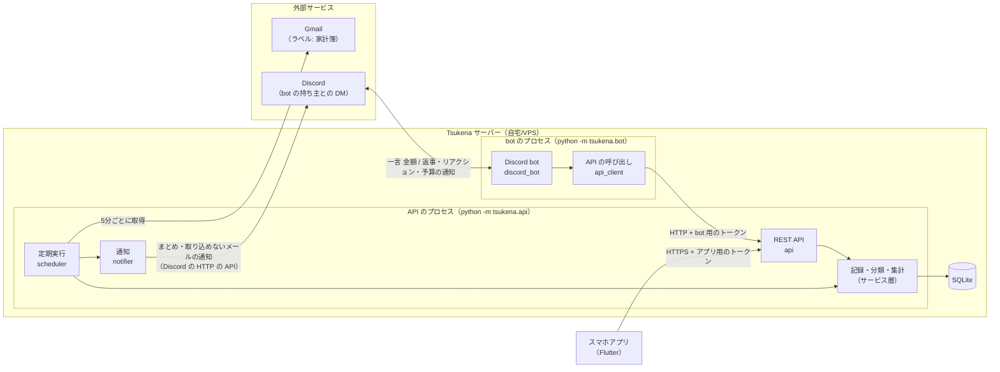
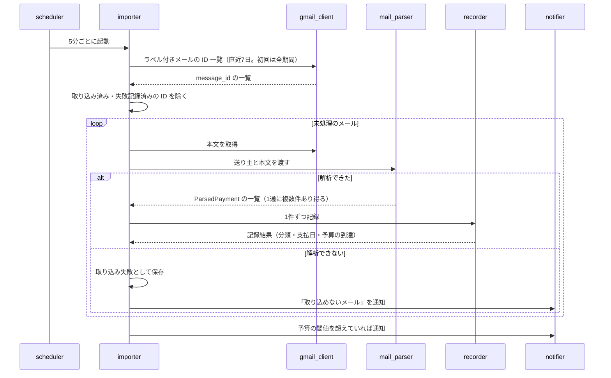
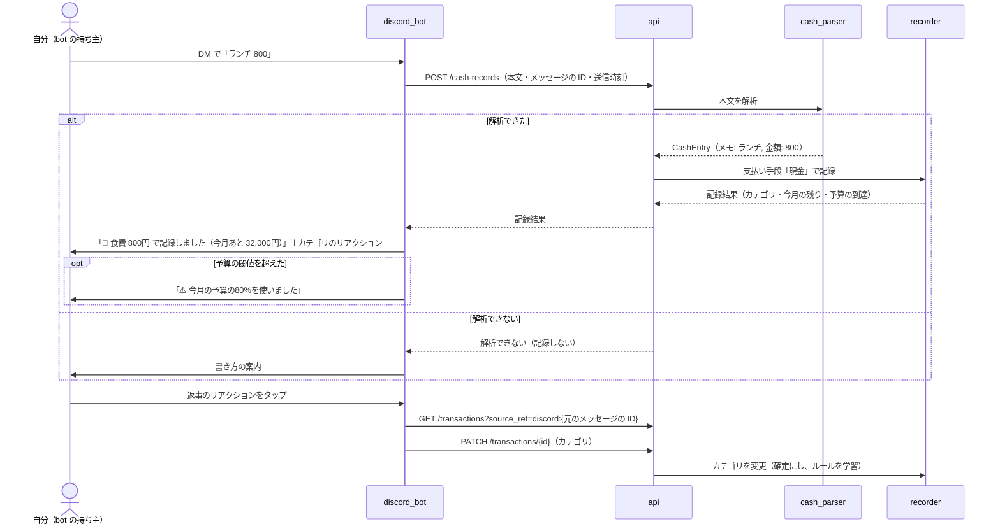
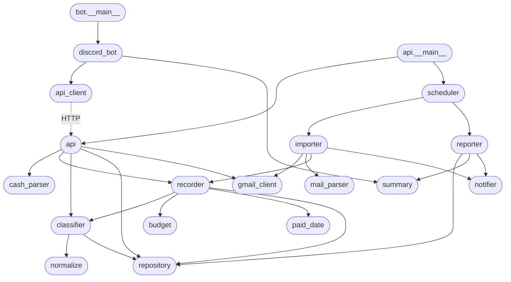

# Tsukena 基本設計

## 1. 目的と設計方針

「記録の手間を極限まで減らす」自分専用の家計簿アプリを作る（→ [README](../README.md)）。
カード・QR決済は Gmail の利用通知メールから自動で記録し、現金だけを Discord の bot に一言送って記録する。
スマホアプリは修正・確認待ちの分類・振り返りと、収入の入力のためだけに使う。

設計上の判断に迷ったときは、次の順で優先する。

1. **続けられるか**: 記録のために自分がする操作を増やさない
2. **壊れても気づけるか**: 取り込めなかったメールや通知の失敗を黙って捨てない
3. **単純であるか**: 利用者は1人。複数人・高負荷のための仕組みは入れない

## 2. 決定事項

| 論点                   | 決定                                  | 記録                                                         |
| ---------------------- | ------------------------------------- | ------------------------------------------------------------ |
| データの保存先・実行環境 | 自宅サーバーまたは VPS に常駐させ、SQLite に保存する | [ADR-0001](./adr/0001-self-hosted-sqlite.md)                 |
| プロセスの分け方       | REST API（定期実行を含む）と Discord bot を別のプロセスで起動する。DB を開くのは API のプロセスだけで、bot は REST API を通して記録を読み書きする | [ADR-0007](./adr/0007-bot-accesses-data-through-api.md)（[ADR-0006](./adr/0006-separate-api-and-bot-processes.md) を置き換え） |
| Discord でのやり取り   | 記録・返事・通知はすべて、bot の持ち主との DM で行う。チャンネルは使わない | [ADR-0008](./adr/0008-record-and-notify-via-owner-dm.md) |
| 自動分類の方法         | 店名ルールのみ（生成AIは使わない）    | [ADR-0002](./adr/0002-merchant-rule-classification.md)       |
| スマホアプリの形態     | ネイティブアプリ                      | [ADR-0003](./adr/0003-native-mobile-app.md)                  |
| スマホアプリの技術     | Flutter（Dart）                       | [ADR-0003](./adr/0003-native-mobile-app.md)                  |
| サーバーの実装言語     | Python（テストは pytest）             | 既存の開発スキル（`generate-ut-test` など）の前提に合わせる |
| 記録の日付と集計の基準 | 利用日と支払日を両方持つ。月の集計と予算は支払日、週のまとめは利用日で数える | [ADR-0004](./adr/0004-monthly-totals-by-paid-date.md) |
| 収入の記録             | 支出とは別に持ち、スマホアプリから手で入力する | [ADR-0005](./adr/0005-income-manual-entry-from-app.md) |

## 3. システム構成



- サーバーは **2つのプロセス**で動かす（→ [ADR-0007](./adr/0007-bot-accesses-data-through-api.md)）。
  1つは REST API と定期実行、もう1つは Discord bot で、それぞれ asyncio 上で動く。
- **DB を開くのは API のプロセスだけ**とする。bot は REST API を HTTP で呼んで記録を読み書きし、サービス層・repository・DB のファイルを import も参照もしない。
  記録のルール（メッセージの分解・支払日の計算・分類・重複排除・予算の判定・ルールの学習）はサービス層だけに置き、入口によって振る舞いがずれないようにする。
- 定期実行は API のプロセスに置く。Gmail の取り込みは DB に書き込むためである。定期実行の通知は、Discord の HTTP の API に bot のトークンで送る。Discord への常時接続（Gateway）は bot のプロセスだけが持つ。
- Discord とのやり取りは、すべて bot の持ち主との DM で行う（→ [ADR-0008](./adr/0008-record-and-notify-via-owner-dm.md)）。持ち主は、Discord のアプリの持ち主を起動のたびに Discord から取り、設定には持たない。
- スマホアプリはサーバーの REST API だけを呼ぶ。Gmail や Discord とは直接やり取りしない。

### 採用予定のライブラリ

| 用途               | ライブラリ                         |
| ------------------ | ---------------------------------- |
| Discord bot        | `discord.py`                       |
| Gmail API          | `google-api-python-client` / `google-auth-oauthlib` |
| REST API           | `FastAPI` + `uvicorn`              |
| 定期実行           | `APScheduler`（AsyncIOScheduler）  |
| DB                 | `sqlite3`（標準ライブラリ）        |
| テスト             | `pytest`                           |

## 4. 処理の流れ

### 4.1 自動取り込み（カード・QR決済）



- 取り込みは API のプロセスの定期実行で動く。通知（`notifier`）は、bot の持ち主への DM を Discord の HTTP の API で送る。

- 対象は Gmail で `家計簿` ラベルが付いたメールだけ。直近7日分を毎回問い合わせ、取り込み済みの ID を除く。
- ただし、最初の取り込みだけは期間を区切らずに問い合わせ、連携より前に届いていたメールも取り込む。済んだことは `settings` の `full_import_done` に残す。
  途中で失敗したら印を付けず、次の周期で全期間からやり直す（取り込み済みの ID は除くので、二重には記録しない）。
  このときは取り込めないメールを1通ごとに通知せず、終わった後に件数を1回だけ通知する。過去のメールが多いと、通知が大量に届くためである。
- 取り込めなかったメールは、アプリから取り込み直せる。メールを ID で取り直して、その場で解析し直す（→ [api_list.md 2.6](./api_list.md#26-取り込めなかったメール)）。
  Gmail の履歴 ID を追う方式より、取りこぼしからの復帰が単純になるため。
- 送り主（From）で解析器を選ぶ。送り主と解析器・支払い手段の対応は `mail_parser` の登録表に持つ。
- 自動取り込みの記録は、分類ルールに当たれば確定、当たらなければ **確認待ち** になる。Discord への返事はしない（通知は週のまとめで行う）。
- 支払日は、記録するときに支払い手段の締め日のルールから計算する（→ [7.1 支払日の決め方](#71-支払日の決め方)）。

### 4.2 Discord bot（現金）



- 反応するのは、bot の持ち主が bot との DM で送ったメッセージだけ（→ [ADR-0008](./adr/0008-record-and-notify-via-owner-dm.md)）。サーバーのチャンネルのメッセージには、持ち主のものでも反応しない。
- bot はメッセージを分解せず、本文をそのまま API に送る。分解・支払日・分類・予算の判定は API の側で行う（→ [ADR-0007](./adr/0007-bot-accesses-data-through-api.md)）。
- 返事には、有効なカテゴリの絵文字をリアクションとして付けておく。タップされた絵文字のカテゴリに直す。
- 現金の支払日は利用日と同じ日になる。そのため、返事の「今月あと」は常に今月の予算の残りである。
- API が止まっているなど、API を呼べなかったときは記録しない。bot は記録できなかったことを返事で知らせる。

### 4.3 スマホアプリ（修正・確認待ち・振り返り・収入）

- 確認待ちの一覧からカテゴリを選ぶと、その記録は確定になり、店名のルールが学習される。
- 記録の修正（金額・利用日・支払日・店名・カテゴリ）と削除ができる。**新しい支出の追加はできない**（現金は Discord、カード・QRは自動のため。二重登録を防ぐ）。
- **収入は、アプリから追加・修正・削除する**（→ [ADR-0005](./adr/0005-income-manual-entry-from-app.md)）。入力するのは入金日・金額・メモ（`給与` など）の3つだけで、カテゴリは持たない。
  収入には自動の入口が無いので、アプリから追加しても二重登録は起きない。
- 月ごとの収入合計・支出合計・収支（収入 − 支出）・予算の残り・カテゴリ別の内訳・明細を見る。支出の月は支払日、収入の月は入金日で数える（来月以降に引き落とされるカードの分も、その月を開けば見られる）。
- 利用日だけを直したときは、支払日をルールから計算し直す。支払日を直したときは、その値をそのまま使う（祝日や売上確定の遅れで計算とずれた場合のため）。
- カテゴリの追加・名前と絵文字の変更、月の予算の変更、Gmail 連携、取り込めなかったメールの確認を行う。

### 4.4 通知

| 通知             | いつ                                   | 内容                                                         |
| ---------------- | -------------------------------------- | ------------------------------------------------------------ |
| 週のまとめ       | 毎週日曜 21:00                         | 月曜〜日曜に**使った**分の支出合計、カテゴリ別の上位3つ、今月の予算の残り、確認待ちの件数 |
| 月のまとめ       | 毎月1日 9:00（前月分）                 | 前月の収入合計と収支、前月に**支払った**分の支出合計と予算、前々月との差、カテゴリ別の内訳 |
| 予算の到達       | 記録した直後（随時）                   | ある月の支出が予算の80% / 100% を超えたとき、対象の月と残りの金額 |
| 取り込めないメール | 自動取り込みで解析に失敗したとき     | 送り主・件名・理由。解析を直してから、アプリで取り込み直すよう案内する |

- 通知はすべて bot の持ち主への DM で送る（→ [ADR-0008](./adr/0008-record-and-notify-via-owner-dm.md)）。現金の記録で予算の閾値を超えたときは bot が返事の後に送り、それ以外は API のプロセスの通知（`notifier`）が送る。
- README の「月末に届く」は、月末日の深夜の支払いと遅れて届く利用通知メールを取りこぼさないよう、**翌月1日の朝**に送る形にしている（→ 残課題 R-3）。
- 予算の到達は、同じ月・同じ閾値につき **1回だけ** 送る（`notification_log` で管理）。修正で下回ってから再び超えても再送しない。
- 予算の到達を判定するのは、**支払日が今月以降の記録だけ**。遅れて届いた前月分のメールでは通知しない。
  カードの分は来月以降の予算から引かれるため、来月以降の月でも判定し、通知には対象の月を書く（例: `⚠️ 11月の予算の80%に達しました（あと 16,000円）`）。

## 5. モジュール構成

パッケージ名は `tsukena`。各モジュールの責務は次の一文に限る。

| 層           | モジュール       | 責務                                                                          |
| ------------ | ---------------- | ----------------------------------------------------------------------------- |
| データ定義   | `model`          | モジュール間で受け渡すデータ構造（記録・カテゴリ・解析結果など）の形だけを定義する |
| 純粋ロジック | `normalize`      | 店名・メモを、分類ルールの照合に使うキー（`merchant_key`）に正規化する         |
|              | `cash_parser`    | Discord のメッセージ本文を、メモと金額に分解する                              |
|              | `mail_parser`    | 利用通知メールの送り主と本文から、支払いの一覧（利用日・金額・店名・支払い手段）を取り出す |
|              | `paid_date`      | 利用日と支払い手段の締め日のルールから、支払日を計算する                      |
|              | `budget`         | 月の支出合計と予算から、残りの金額と新たに超えた閾値を計算する                |
|              | `summary`        | 集計結果から、週・月のまとめと各通知の文面を組み立てる                        |
| 永続化       | `repository`     | SQLite への読み書きを行い、SQL を外に漏らさない                               |
| サービス     | `classifier`     | `merchant_key` から分類ルールを引いてカテゴリを決め、修正されたときにルールを学習する |
|              | `recorder`       | 1件の支払いの支払日を決め、分類・重複排除して保存し、その月の残りと予算の到達を返す |
|              | `importer`       | Gmail から未処理のメールを取り出し、解析して記録する一連の取り込みを行う     |
|              | `reporter`       | 期間を集計し、まとめを組み立てて通知に渡す                                    |
| 外部接続     | `gmail_client`   | Gmail API との認証（連携の開始・完了と、認証情報の保存・更新）とメールの取得だけを行う |
|              | `notifier`       | bot の持ち主への DM の送信だけを、Discord の HTTP の API で行う               |
|              | `discord_bot`    | Discord のイベント（DM のメッセージ・リアクション）を受けて、REST API を呼ぶ   |
|              | `api_client`     | bot から REST API を HTTP で呼び、JSON と `model` の構造を相互に変換する      |
|              | `api`            | スマホアプリと bot 向けの REST API を提供する                                 |
|              | `scheduler`      | 取り込み・週のまとめ・月のまとめを決まった時刻に起動する                      |
| 起動         | `config`         | 環境変数と設定ファイル（支払い手段の締め日のルールを含む）から設定値を読み込む |
|              | `api.__main__`   | REST API と定期実行を組み立てて、API のプロセスを起動する                     |
|              | `bot.__main__`   | Discord bot を組み立てて、bot のプロセスを起動する                            |

- `discord_bot` と `api_client` は bot のプロセスで動き、`tsukena/bot/` に置く。それ以外は API のプロセスで動く（`model` と純粋ロジックの `summary` は bot のプロセスからも使う）。

### 5.1 スマホアプリ（`app/lib`）

機能ごとにフォルダを分け（`features/`）、画面（`pages/`）はそれらを組み合わせて作る。
各機能は REST API（→ [10.2](#102-rest-apiスマホアプリ向け)）の資源1つに対応させる。

#### features 一覧

| feature          | 責務                                                                 | 使う API                                   | 主な entities                                  |
| ---------------- | -------------------------------------------------------------------- | ------------------------------------------ | ---------------------------------------------- |
| `expense`        | 支出の記録の一覧・修正・削除と、確認待ちの記録のカテゴリ選択。**追加はしない** | `/transactions`、`/transactions/{id}`      | `Expense`、`ExpenseUpdate`                     |
| `income`         | 収入の一覧・追加・修正・削除                                         | `/incomes`、`/incomes/{id}`                | `Income`、`IncomeInput`、`IncomeUpdate`          |
| `month_summary`  | 月の収入合計・支出合計・収支・予算の残り・カテゴリ別の内訳の取得     | `/months/{YYYY-MM}/summary`                | `MonthlySummary`、`CategoryTotal`              |
| `category`       | カテゴリの一覧・追加と、名前・絵文字・表示順の変更                   | `/categories`、`/categories/{id}`          | `Category`、`CategoryUpdate`                   |
| `budget`         | 月の予算の取得・変更                                                 | `/budget`                                  | `Budget`                                       |
| `import_failure` | 取り込めなかったメールの一覧と、取り込み直し                         | `/import-failures`、`/import-failures/{message_id}/retry` | `ImportFailure`                 |
| `gmail_link`     | Gmail 連携の開始（Google の同意画面をブラウザで開く）                | `/oauth/google/start`                      | なし                                           |

- 各 feature は、`entities/`（API の JSON と相互に変換するデータの形）・`repositories/`（API の呼び出し）・`widgets/`（その機能の部品）を持つ。
- entities の項目名と意味は、サーバーの `model` の構造（`docs/module/model_design.md`）に揃える。`Expense` はサーバーの `Transaction` に当たる。
- feature から別の feature を参照してよいのは `entities/` だけとする（例: `expense` の一覧でカテゴリの名前と絵文字を出すために `category` の `Category` を使う）。repositories と widgets を組み合わせるのは pages の役目である。
- API のベース URL とトークンは、feature ごとに持たず共通の部品（`core/`）から渡す（→ 残課題 R-1）。

#### pages 一覧

| page                        | 内容                                                                 | 使う feature                                  |
| --------------------------- | -------------------------------------------------------------------- | --------------------------------------------- |
| `month_page`（起動時の画面）| 月を切り替えて、収入合計・支出合計・収支・予算の残り・カテゴリ別の内訳を見る。各一覧へ移る | `month_summary`                       |
| `expense_list_page`         | 月の支出の明細（支払日の月で絞り込む）                               | `expense`、`category`                         |
| `expense_edit_page`         | 支出1件の修正（金額・利用日・支払日・店名・カテゴリ）と削除          | `expense`、`category`                         |
| `pending_page`              | 確認待ちの記録の一覧。カテゴリを選ぶと確定する                       | `expense`、`category`                         |
| `income_list_page`          | 月の収入の一覧（入金日の月で絞り込む）                               | `income`                                      |
| `income_edit_page`          | 収入1件の追加・修正（入金日・金額・メモ）と削除                      | `income`                                      |
| `settings_page`             | 月の予算の変更、カテゴリの管理、Gmail 連携、取り込めなかったメールの確認 | `budget`、`category`、`gmail_link`、`import_failure` |

- 支出を新しく追加する画面は作らない（→ [4.3](#43-スマホアプリ修正確認待ち振り返り収入)）。

## 6. 依存の向き



- すべてのモジュールは `model` と `config` を参照してよい（図では省略）。
- bot のプロセスの側（`bot.__main__` / `discord_bot` / `api_client`）は、API のプロセスの側を import しない。API との間は HTTP（図の点線）だけでつながる（→ [ADR-0007](./adr/0007-bot-accesses-data-through-api.md)）。
  bot の側が import してよいのは `model`・`config` と、純粋ロジックの `summary` だけとする。サービス層・`repository`・DB のファイルは知らない。
- **上から下への一方向だけ**。下の層は上の層を知らない（`recorder` は Discord も Gmail も知らない）。
- 純粋ロジック（`normalize` / `cash_parser` / `mail_parser` / `paid_date` / `budget` / `summary`）は DB も外部サービスも呼ばない。
  入力だけから結果が決まる関数として作り、単体テストの中心にする。
- 外部サービスを呼ぶのは `gmail_client` / `notifier` / `discord_bot` / `api_client` だけ。サービス層のテストでは `gmail_client` と `notifier` を、bot のテストでは `api_client` を差し替える。
- `api` が `gmail_client` を呼ぶのは、Gmail 連携（`/oauth/google/start`・`/oauth/google/callback`）のときだけである。認可コードを認証情報に交換して保存する処理を `gmail_client` に置き、Google の認証のライブラリを使うモジュールを1つに限るためである。連携の途中の `state` は、`api` のプロセスのメモリに10分だけ持つ。
- `importer` が取り込み失敗を通知するときも、`notifier` に文面を渡すだけにする（文面は `summary` が組み立てる）。

## 7. データフロー

どの値をどこで確定させるかを、ここで固定する。

| 値               | 確定させる場所          | 決め方                                                                 |
| ---------------- | ----------------------- | ---------------------------------------------------------------------- |
| 利用日           | `mail_parser` / `api` | メールの利用日（本文）、または Discord のメッセージ送信時刻（JST）の日付。送信時刻は bot が API に渡す |
| 時刻             | 同上                    | メールに利用時刻があれば入れ、無ければ空。**受信時刻では埋めない**（日付がずれるため） |
| 支払日           | `recorder`（`paid_date` を使う） | 利用日と支払い手段の締め日のルールから計算する（→ [7.1](#71-支払日の決め方)） |
| 金額             | `mail_parser` / `cash_parser` | 円単位の正の整数。カンマ・「円」・全角数字を取り除いた結果           |
| 店名・メモ       | `mail_parser` / `cash_parser` | 表示用に**生の文字列のまま**持つ。正規化した値は別に持つ          |
| 照合キー         | `classifier`（`normalize` を使う） | 店名・メモを正規化した値（`merchant_key`）                     |
| カテゴリ・状態   | `classifier`            | → [8. 分類の方針](#8-分類の方針)                                       |
| 支払い手段       | `mail_parser` / `api` | メールの送り主に対応する名前（例: 楽天カード）、bot から送られた記録なら「現金」 |
| 重複排除キー     | `mail_parser` / `api` | `gmail:{message_id}:{メール内の連番}` / `discord:{message_id}`（Discord のメッセージの ID は bot が API に渡す） |
| 集計の月         | `budget` / `reporter`   | **支払日** が属する月（JST）                                           |
| 集計の週         | `reporter`              | **利用日** が属する週（JST）。週は月曜始まり・日曜終わり               |
| 収入の日付・金額・メモ | `api`             | アプリで入力した値。金額は円単位の正の整数、メモは生の文字列のまま持つ |
| 収入の集計の月   | `reporter` / `api`      | **入金日** が属する月（JST）                                           |

- 金額はすべて **整数（円）** で扱う。浮動小数点は使わない。
- 時刻はすべて **JST（Asia/Tokyo）** で扱う。
- 同じ重複排除キーの記録は2度保存しない（`recorder` が判定し、DB の一意制約でも守る）。

### 7.1 支払日の決め方

→ [ADR-0004](./adr/0004-monthly-totals-by-paid-date.md)

支払い手段ごとに、設定ファイル（`config.toml`）に締め日のルールを書く。

```toml
[payment_methods."現金"]
timing = "immediate"            # 利用日に支払う

[payment_methods."PayPay"]
timing = "immediate"

[payment_methods."楽天カード"]
timing = "card"
closing_day = 31                # 締め日（31 は月末を表す）
withdrawal_day = 27             # 引き落とし日
withdrawal_month_offset = 1     # 締めた月の何か月後に引き落とすか
```

| 支払い手段の種類       | 支払日                                                                 |
| ---------------------- | ---------------------------------------------------------------------- |
| `immediate`（現金・即時に引き落とす決済） | 利用日と同じ日                                       |
| `card`（締めてから引き落とす決済） | 利用日を含む締め期間の締め日の月から、`withdrawal_month_offset` か月後の `withdrawal_day` |

- 締め期間は「前の締め日の翌日〜締め日」とする。例: 15日締めなら、10月16日〜11月15日の利用が11月締めになる。
- 締め日・引き落とし日が、その月に無い日（2月30日など）のときは、その月の末日とする。
- 土日祝による引き落とし日の繰り延べは計算しない。ずれが問題になる場合はアプリで支払日を直す（→ 残課題 R-10）。
- 分割払い・ボーナス払い・リボ払いは扱わず、すべて1回払いとして計算する。
- `mail_parser` の登録表と、bot から送られた記録に使う支払い手段（`現金`）は、すべて設定ファイルにルールを持たなければならない。
  起動時に照合し、ルールの無い支払い手段があればプロセスを起動しない（黙って利用日で埋めないため）。

## 8. 分類の方針

→ [ADR-0002](./adr/0002-merchant-rule-classification.md)

| 状況                                         | カテゴリ                | 状態     |
| -------------------------------------------- | ----------------------- | -------- |
| `merchant_key` が分類ルールに完全一致した    | ルールのカテゴリ        | 確定     |
| `merchant_key` がルールに無い                | 未設定                  | 確認待ち |
| 店名・メモが空（bot に金額だけ送った）       | 未設定（「未分類」と表示） | 確認待ち |
| アプリ・リアクションでカテゴリを選んだ       | 選んだカテゴリ          | 確定     |

- 照合は **正規化したキーの完全一致** だけにする。部分一致や前方一致はしない（結果を予測できるようにするため）。
- 正規化（`normalize`）は、全角英数字と記号の半角化、英字の小文字化、前後と連続する空白の除去までとする。
- カテゴリを選んだときは、その記録の `merchant_key` に対するルールを作成または上書きする（**最後に選んだものが勝つ**）。
  店名・メモが空の記録ではルールを作らない。
- ルールの学習は、それ以降の記録にだけ効く。過去の確認待ちの記録には遡って適用しない（→ 残課題 R-4）。
- 自動取り込みの店名（例: `スターバックス`）と bot のメモ（例: `ランチ`）は、同じルール表で扱う。

## 9. データモデル

SQLite のテーブル。詳細な型と不変条件は `docs/module/model_design.md` と `repository` の設計書で定める。

### transactions（記録）

| 列               | 型        | 必須 | 内容                                               |
| ---------------- | --------- | ---- | -------------------------------------------------- |
| `id`             | INTEGER   | 〇   | 主キー                                             |
| `occurred_date`  | TEXT      | 〇   | 利用日。使った日（`YYYY-MM-DD`、JST）              |
| `occurred_time`  | TEXT      | -    | 使った時刻（`HH:MM`）。分からなければ NULL          |
| `paid_date`      | TEXT      | 〇   | 支払日。口座などからお金が出ていく日（`YYYY-MM-DD`、JST） |
| `amount`         | INTEGER   | 〇   | 金額（円、正の整数）                               |
| `merchant`       | TEXT      | 〇   | 店名・メモ（生の文字列）。無ければ空文字           |
| `merchant_key`   | TEXT      | 〇   | 正規化した店名・メモ。無ければ空文字               |
| `memo`           | TEXT      | 〇   | 買った物などの覚え書き（アプリで書く）。分類には使わない。無ければ空文字 |
| `category_id`    | INTEGER   | -    | カテゴリ。未設定なら NULL                          |
| `status`         | TEXT      | 〇   | `confirmed`（確定） / `pending`（確認待ち）         |
| `payment_method` | TEXT      | 〇   | 支払い手段（`現金`、`楽天カード` など）            |
| `source`         | TEXT      | 〇   | `gmail` / `discord`                                |
| `source_ref`     | TEXT      | 〇   | 重複排除キー（一意）                               |
| `created_at`     | TEXT      | 〇   | 作成日時                                           |
| `updated_at`     | TEXT      | 〇   | 更新日時                                           |

- `status` が `confirmed` なら `category_id` は必ず入っている。
- `paid_date` は `occurred_date` より前にならない。
- 削除は物理削除とする。消した Gmail 由来の記録が再び取り込まれないよう、`source_ref` は `deleted_refs` に残す。

### incomes（収入）

→ [ADR-0005](./adr/0005-income-manual-entry-from-app.md)

| 列              | 型      | 必須 | 内容                                       |
| --------------- | ------- | ---- | ------------------------------------------ |
| `id`            | INTEGER | 〇   | 主キー                                     |
| `received_date` | TEXT    | 〇   | 入金日（`YYYY-MM-DD`、JST）                |
| `amount`        | INTEGER | 〇   | 金額（円、正の整数）                       |
| `memo`          | TEXT    | 〇   | メモ（`給与` など、生の文字列）。無ければ空文字 |
| `created_at`    | TEXT    | 〇   | 作成日時                                   |
| `updated_at`    | TEXT    | 〇   | 更新日時                                   |

- 支出の記録（`transactions`）とは別のテーブルにする。カテゴリ・分類・重複排除・予算の判定は、どれも収入には当てはまらないためである。
- 削除は物理削除とする。自動の入口が無いので、削除した記録を覚えておく必要は無い。
- 月の予算とは結び付けない。予算は支出の上限として、これまでどおり設定値で持つ。

### categories（カテゴリ）

| 列           | 型      | 必須 | 内容                               |
| ------------ | ------- | ---- | ---------------------------------- |
| `id`         | INTEGER | 〇   | 主キー                             |
| `name`       | TEXT    | 〇   | 名前（一意）                       |
| `emoji`      | TEXT    | 〇   | bot の返事とリアクションに使う絵文字（一意） |
| `sort_order` | INTEGER | 〇   | 表示順                             |

- 初期値: 食費 / 日用品 / 交通 / 娯楽 / 交際 / 衣服 / 医療 / 固定費 / その他。
- 1階層のみ。追加と名前・絵文字・表示順の変更はできるが、**削除はできない**（過去の記録が参照しているため）。

### その他のテーブル

| テーブル           | 内容                                                                 |
| ------------------ | -------------------------------------------------------------------- |
| `merchant_rules`   | `merchant_key`（主キー）→ `category_id` の分類ルール                  |
| `settings`         | 月の予算、Gmail ラベル名、全期間の取り込みを済ませたか。1行だけ持つ。Discord の ID は持たない（→ [ADR-0008](./adr/0008-record-and-notify-via-owner-dm.md)） |
| `notification_log` | 送った通知の種類と対象期間（例: `budget_80` / `2026-09`）。一意制約で重複送信を防ぐ |
| `import_failures`  | 解析できなかったメールの `message_id`・送り主・件名・理由・日時       |
| `deleted_refs`     | 削除した記録の `source_ref`                                          |

- Google の認証情報（リフレッシュトークン）は DB に入れず、サーバー上のファイル（`creds/token.json`）に、持ち主だけが読み書きできる権限（`600`）で保存する。
  Google Cloud で作った OAuth クライアントの情報も、同じフォルダ（`creds/credentials.json`）に置く。`creds/` は git では管理しない。

## 10. 外部インターフェース

### 10.1 Discord のメッセージ

| 送る内容              | 解釈                                  |
| --------------------- | ------------------------------------- |
| `ランチ 800`          | メモ「ランチ」、800円                 |
| `800`                 | メモ無し、800円（未分類）             |
| `コンビニ 1,280円`    | メモ「コンビニ」、1,280円             |
| `ランチ　８００`      | 全角の空白・数字も受け付ける          |
| 上記以外（金額が無い、0円以下など） | 記録せず、書き方を返す    |

- 最後の空白区切りの部分を金額、それより前をメモとして扱う。詳細は `cash_parser` の設計書で定める。

### 10.2 REST API（スマホアプリ向け）

スマホアプリと bot が呼ぶ。見出しの「スマホアプリ向け」は、他の文書からの参照（アンカー）を保つために残している。

`/oauth/google/callback` を除き、すべて `Authorization: Bearer {トークン}` を必要とする。`/oauth/google/callback` は Google からのリダイレクトでブラウザが呼ぶためヘッダーを付けられず、代わりに `state` で確かめる（→ [api_list.md 2.7](./api_list.md#27-gmail-連携)）。トークンはスマホアプリ用と bot 用の2つをサーバーの設定に持ち、エンドポイントごとにどちらで呼べるかを決める（→ [ADR-0007](./adr/0007-bot-accesses-data-through-api.md)）。
現金の記録（`POST /cash-records`）は bot 用のトークンでしか呼べない。スマホアプリから支出を追加できない方針（→ [4.3](#43-スマホアプリ修正確認待ち振り返り収入)）を、API の側で守るためである。
各エンドポイントの入力・出力・エラーは [API 一覧](./api_list.md) で定める。

| メソッド | パス                               | 内容                                         |
| -------- | ---------------------------------- | -------------------------------------------- |
| GET      | `/months/{YYYY-MM}/summary`        | 月の収入合計・支出合計・収支・予算・残り・カテゴリ別の内訳（支出は支払日、収入は入金日で数える） |
| GET      | `/transactions?month=&status=&source_ref=` | 記録の一覧（月・状態・重複排除キーで絞り込み。月は支払日で絞り込む。重複排除キーは bot がリアクションから記録を探すときに使う） |
| PATCH    | `/transactions/{id}`               | 記録の修正（カテゴリを選ぶと確定・ルール学習） |
| DELETE   | `/transactions/{id}`               | 記録の削除                                   |
| GET      | `/incomes?month=`                  | 収入の一覧（入金日の月で絞り込み）           |
| POST     | `/incomes`                         | 収入の追加                                   |
| PATCH    | `/incomes/{id}`                    | 収入の修正（入金日・金額・メモ）             |
| DELETE   | `/incomes/{id}`                    | 収入の削除                                   |
| GET      | `/categories`                      | カテゴリの一覧                               |
| POST     | `/categories`                      | カテゴリの追加                               |
| PATCH    | `/categories/{id}`                 | 名前・絵文字・表示順の変更                   |
| GET/PUT  | `/budget`                          | 月の予算の取得・変更                         |
| GET      | `/import-failures`                 | 取り込めなかったメールの一覧                 |
| DELETE   | `/import-failures/{message_id}`    | 失敗の記録を消し、次の取り込みで解析し直す   |
| POST     | `/import-failures/{message_id}/retry` | 取り込めなかったメールをその場で取り込み直す |
| POST     | `/cash-records`                    | 現金の記録（bot 用のトークンだけ。Discord のメッセージの本文・ID・送信時刻を受け取り、分解して記録する） |
| GET      | `/oauth/google/start`              | Gmail 連携の開始（Google の同意画面へ）       |
| GET      | `/oauth/google/callback`           | Gmail 連携の完了（認証情報を保存）           |

## 11. 非機能

| 観点           | 方針                                                                 |
| -------------- | -------------------------------------------------------------------- |
| 利用者         | 1人。ユーザー管理・権限管理は持たない                                 |
| Gmail の権限   | `gmail.readonly` を使う。スコープはラベル単位に絞れないため、**アプリ側で `家計簿` ラベルのメールだけを問い合わせる** |
| 外部への公開   | API は Cloudflare Tunnel を通してだけ届かせ、`127.0.0.1` で待ち受ける（→ [ADR-0009](./adr/0009-web-app-via-cloudflare-tunnel.md)）。Web 版のアプリは GitHub Pages に置き、API は Pages のオリジンを CORS で許可する。守りはトークンだけで、アプリのトークンはビルドに入れず画面で入力する（→ [ADR-0010](./adr/0010-web-app-on-github-pages.md)）。bot から API へは同じ機械の中で呼ぶ。Discord bot と Gmail はサーバーからの外向き通信だけで動く |
| 秘密情報       | Discord の bot のトークンと API のトークン（アプリ用・bot 用）は環境変数で、Google のクライアント情報と認証情報は `creds/` のファイルで渡し、どれもリポジトリに入れない（→ [9](#9-データモデル)）。Discord の bot のトークンは、bot のプロセスと API のプロセス（通知の送信）の両方が使う |
| 障害時         | 取り込みで例外が起きても、プロセスは止めず次の周期で再試行する。解析できないメールは `import_failures` に残して通知する。bot のプロセスと API のプロセスは別々に止まり、別々に再起動する |
| 同時の書き込み | SQLite を開くのは API のプロセスだけ（→ [ADR-0007](./adr/0007-bot-accesses-data-through-api.md)）。API の中でもリクエストは複数のスレッドで動くため、WAL モードとロック待ち（`busy_timeout`）を指定し、待ちきれなかったときは書き込みの例外として扱う |
| ログ           | 標準出力に出し、常駐の仕組み（systemd など）に集めさせる              |
| バックアップ   | SQLite のバックアップの仕組みで毎日1回写しを取り、30日分を残す（`python -m tsukena.backup`、systemd のタイマー）。保存先は同じ機械の中（→ 残課題 R-2） |

## 12. フォルダ構成

```
Tsukena/
├── docs/
│   ├── design.md              … 本書（基本設計）
│   ├── adr/                   … 設計判断の記録
│   ├── module/                … モジュール設計書（{module}_design.md）
│   └── test/
│       └── ut-test-design.csv … 単体テスト設計書
├── creds/                    … Google の OAuth クライアントの情報と認証情報。git では管理しない
├── db/                       … SQLite の DB（tsukena.db）。git では管理しない
├── sql/
│   ├── create_tables.sql      … テーブルの定義
│   └── sample/                … テーブルごとのサンプルデータ（NN_{テーブル名}.sql。番号の順に流す）
├── tsukena/                   … サーバー（Python パッケージ）
│   ├── api/                   … REST API（`python -m tsukena.api` で起動する）
│   │   └── __main__.py        … API と定期実行のプロセスの起動
│   ├── bot/                   … Discord bot（`python -m tsukena.bot` で起動する）
│   │   ├── __main__.py        … bot のプロセスの起動
│   │   ├── discord_bot.py
│   │   └── api_client.py      … REST API の呼び出し
│   └── mail/                  … メールの取り込みに使う部品
│       ├── gmail_client.py
│       └── mail_parser/       … 送り主ごとの解析器を置く
├── tests/
│   └── tsukena/               … test__{module}.py
└── app/                       … スマホアプリ（Flutter プロジェクト）
    ├── pubspec.yaml           … アプリの設定・依存パッケージ
    ├── lib/                   … Dart の実装（→ 5.1）
    │   ├── main.dart
    │   ├── core/              … API のベース URL・トークンなど共通の部品
    │   ├── features/{feature}/
    │   │   ├── entities/
    │   │   ├── repositories/
    │   │   └── widgets/
    │   └── pages/             … 画面（{name}_page.dart）
    ├── test/                  … Flutter アプリのテスト
    ├── android/               … Android 用のひな形
    └── ios/                   … iOS 用のひな形
```

当面は Web 版（`web/`）を GitHub Actions でビルドし、GitHub Pages に置く（→ [ADR-0010](./adr/0010-web-app-on-github-pages.md)）。Android・iOS 用のひな形は残しておく。

## 13. 残課題

| ID  | 論点                                   | 補足                                                                 |
| --- | -------------------------------------- | -------------------------------------------------------------------- |
| R-1 | ~~スマホアプリから API に届く経路~~    | 決定済み: API は Cloudflare Tunnel、アプリは GitHub Pages（→ [ADR-0009](./adr/0009-web-app-via-cloudflare-tunnel.md)、[ADR-0010](./adr/0010-web-app-on-github-pages.md)） |
| R-2 | バックアップの保存先                   | 同じ機械の中だけでは機械の故障で失われる。外部への退避先を決める     |
| R-3 | 月のまとめを送る時刻                   | README は「月末」。本書では翌月1日 9:00 とした。確認する              |
| R-4 | 学習したルールを過去の確認待ちに適用するか | 本書では適用しない。同じ店が溜まっていると何度も選ぶことになる       |
| R-5 | ~~Flutter アプリの対象 OS と配布方法~~ | 決定済み: 当面は Web 版を GitHub Pages で配信する（→ [ADR-0010](./adr/0010-web-app-on-github-pages.md)）。ネイティブアプリにするかは使ってから決め直す |
| R-6 | 対応するカード会社・決済サービスの一覧 | 解析器を作る対象。実際の利用通知メールの見本が必要                   |
| R-7 | 返金・取消の通知メールの扱い           | 本書では対象外（解析できないメールとして通知される）                 |
| R-8 | カテゴリが20個を超えたときのリアクション | Discord の1メッセージに付けられるリアクションは20個まで              |
| R-11 | 定期的な収入の自動記録                | 給与のように毎月入る収入も、本書では毎月アプリで入力する（→ ADR-0005） |
| R-10 | 引き落とし日の土日祝による繰り延べ    | 本書では計算しない。月末が引き落とし日のカードでは、翌月にずれて月の集計が変わる |


以下フォルダ構成を採用
https://zenn.dev/koudai/articles/aca5a6342b36bf