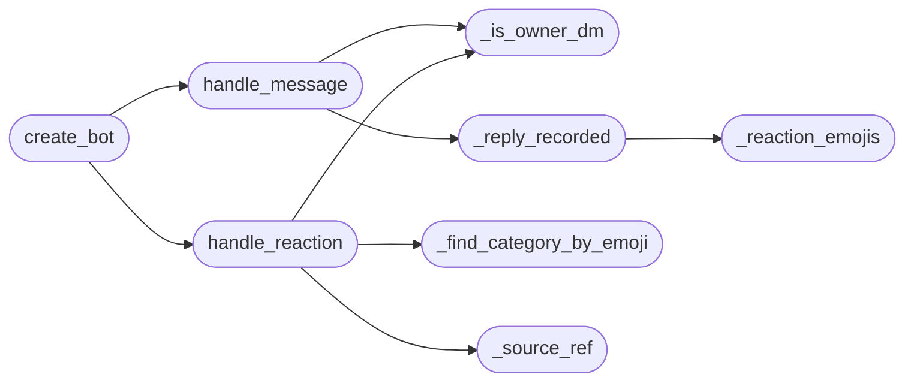
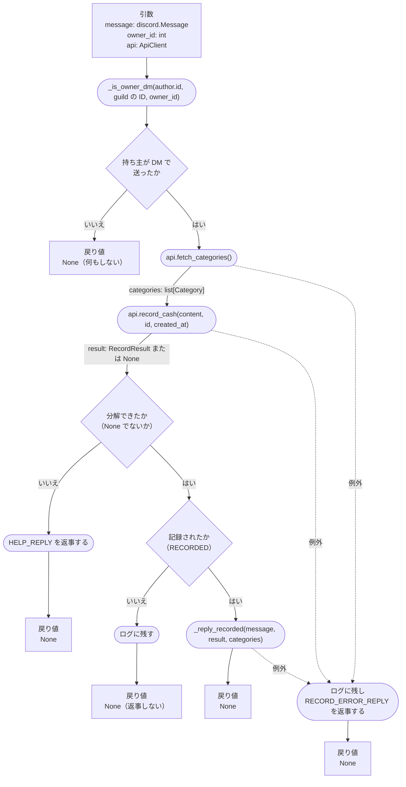
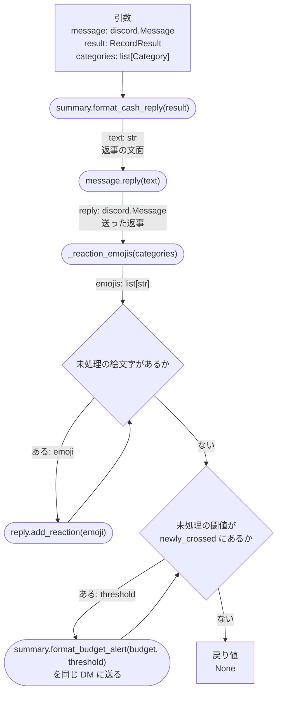
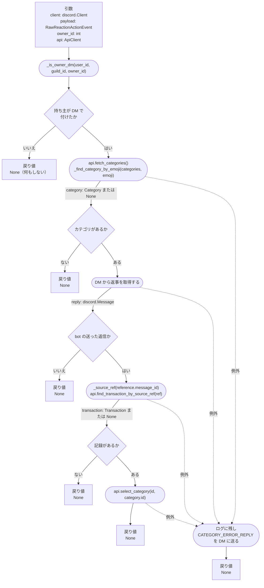
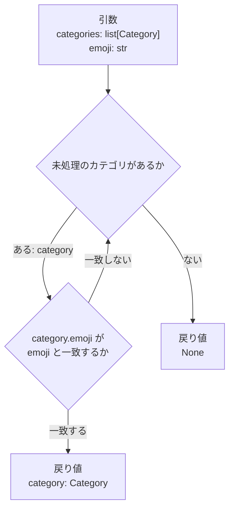

# tsukena/bot/discord_bot.py

<!-- 見出しは実装先のファイル名（またはモジュール名）。表記は採用言語の慣習に従う -->

## 背景・目的
<!-- なんのために必要なのか -->
現金での支払いは、カードや QR 決済と違って利用通知メールが届かないため、自動では記録できない。
かといってスマホアプリから支出を追加できるようにすると、カードの分を手で入れてしまい二重登録が起きうる（→ [design.md 4.3](../design.md#43-スマホアプリ修正確認待ち振り返り収入)）。
そこで現金の分だけは、Discord で bot に DM で「ランチ 800」と一言送れば記録できるようにする（→ [design.md 4.2](../design.md#42-discord-bot現金)）。
記録したら、カテゴリと今月の予算の残りを返事で知らせ、分類が違っていれば返事に付けたリアクションをタップするだけで直せるようにする。

本モジュールは、bot の持ち主との DM で起きた Discord のイベント（メッセージの投稿とリアクションの追加）を受けて REST API を呼び、その結果を Discord に返すことだけを責務とする。
メッセージの分解、支払日の計算、分類、予算の判定は行わず、DB にも触れない。これらはすべて REST API の側で行う（→ [ADR-0007](../adr/0007-bot-accesses-data-through-api.md)）。

## 関数一覧
<!-- どのような関数があるのか -->
| 関数名（呼び出し階層）       | 引数                                                                                   | 戻り値           | 概要                                                         |
| ---------------------------- | -------------------------------------------------------------------------------------- | ---------------- | ------------------------------------------------------------ |
| `create_bot`                 | api: ApiClient                                                                         | discord.Client   | 持ち主を取り、イベントの受け口を登録した Discord のクライアントを作る |
| `handle_message`             | message: discord.Message, owner_id: int, api: ApiClient                                | None             | 持ち主が DM で送った一言を、REST API で現金の支出として記録して返事をする |
| `　_is_owner_dm`             | user_id: int, guild_id: int \| None, owner_id: int                                     | bool             | 持ち主が DM で行った操作かを判定する                         |
| `　_reply_recorded`          | message: discord.Message, result: RecordResult, categories: list[Category]             | None             | 記録した結果を返事で知らせ、カテゴリのリアクションと予算の通知を付ける |
| `　　_reaction_emojis`       | categories: list[Category]                                                             | list[str]        | 返事に付けるカテゴリの絵文字を、表示順に上限まで並べる       |
| `handle_reaction`            | client: discord.Client, payload: discord.RawReactionActionEvent, owner_id: int, api: ApiClient | None     | 返事に付けたリアクションのタップを受けて、REST API で記録のカテゴリを変える |
| `　_is_owner_dm`             | （上と同じ）                                                                            | bool             | （上と同じ）                                                 |
| `　_find_category_by_emoji`  | categories: list[Category], emoji: str                                                 | Category \| None | 絵文字に対応するカテゴリを探す                               |
| `　_source_ref`              | message_id: int                                                                        | str              | Discord のメッセージ ID から重複排除キーを作る               |

<!-- 並び順は呼び出し階層順（入口 → 呼ばれる順）。階層が無いモジュールは列名を「関数名」にする -->
<!-- 公開関数と非公開関数は、採用言語の慣習（命名規則・アクセス修飾子・エクスポートの有無など）で見分けられるようにする -->

- 先頭が `_` の関数は非公開関数とする。モジュールの外から呼ぶ入口は、起動するときにクライアントを作ること（`create_bot()`）だけである。
- メッセージを受けたとき（`handle_message()`）とリアクションを受けたとき（`handle_reaction()`）の2つは、イベントの受け口から呼ばれる。単体テストから直接呼べるよう公開関数にする。
- `handle_message` と `handle_reaction` と `_reply_recorded` は、Discord と REST API を呼ぶため非同期の関数（`async def`）とする。それ以外は同期の関数である。

### 関数間の依存
<!-- どの関数がどの関数を呼ぶのか -->
<!-- 関数が3つ以上ある場合に置く -->


記録する系統（`handle_message`）とカテゴリを変える系統（`handle_reaction`）は、互いを呼ばない。
2つの系統は、REST API の側で作られる重複排除キー（`discord:{message_id}`）を通してだけつながる。リアクションを受けたときは、返事の元になったメッセージの ID から記録を探すためである（→ [リアクションと記録の結び付け方](#リアクションと記録の結び付け方)）。


## 依存関係
<!-- なんのモジュールに依存しているのか -->
| モジュール        | 用途                                                                                   |
| ----------------- | -------------------------------------------------------------------------------------- |
| `bot.api_client`  | REST API を呼ぶ。現金の記録・カテゴリの一覧・重複排除キーからの記録の取得・カテゴリの変更 |
| `summary`         | 記録した返事と、予算の到達の通知の文面を組み立てる（純粋ロジック）                     |
| `model`           | `RecordResult` / `RecordOutcome` / `Category` / `Transaction` / `BudgetStatus` / `Source` |
| `discord`         | Discord のクライアント・イベント・メッセージの送信（外部ライブラリ。`discord.py`）     |
| `logging`         | 記録しなかったメッセージと、例外の記録（標準ライブラリ）                               |

本モジュールは、bot のプロセスの起動（`bot.__main__`）から呼ばれる。起動は REST API の呼び出し（`ApiClient`）を作ってからクライアントを作り（`create_bot()`）、Discord に接続する。
Discord のトークン、REST API の URL と bot 用のトークンは、起動が設定の読み込み（`config`）から受け取る。本モジュールは、どれも知らない。

本モジュールは、Discord と REST API の値の変換だけを行う。
サービス層（`recorder` / `classifier` など）・`repository`・DB のファイルは import も参照もしない（→ [design.md 6. 依存の向き](../design.md#6-依存の向き)）。
メッセージの分解の規則（`cash_parser`）、支払日・分類・重複排除・予算の判定（`recorder`）は、REST API の側で動く。
本モジュールが送る通知は、現金の記録で予算の閾値を超えたときのものだけである。週と月のまとめ・取り込めないメールの通知は、API のプロセスの通知（`notifier`）が送る（→ [design.md 4.4](../design.md#44-通知)）。

本書の時点で、呼び出し先の `bot.api_client` と `summary` には設計書が無い。本モジュールは次の関数があることを前提とし、名前と型はそれぞれの設計書を書くときに確定させる。

| 呼び出し先                                       | 前提とするシグネチャ                                                         | 前提とする振る舞い                                                     |
| ------------------------------------------------ | ---------------------------------------------------------------------------- | ---------------------------------------------------------------------- |
| `ApiClient.record_cash()`                        | `async (text: str, message_id: int, sent_at: datetime) -> RecordResult \| None` | `POST /cash-records` を呼ぶ。本文を分解できなかった（`400`）ときは `None` を返す（→ [api_list.md 2.8](../api_list.md#28-現金の記録)） |
| `ApiClient.fetch_categories()`                   | `async () -> list[Category]`                                                 | `GET /categories` を呼ぶ。表示順の小さい順、同じなら ID の小さい順に返す |
| `ApiClient.find_transaction_by_source_ref()`     | `async (source_ref: str) -> Transaction \| None`                             | `GET /transactions?source_ref=` を呼ぶ。見つからなければ `None` を返す   |
| `ApiClient.select_category()`                    | `async (transaction_id: int, category_id: int) -> Transaction \| None`       | `PATCH /transactions/{id}` にカテゴリだけを送る。記録が無い（`404`）ときは `None` を返す |
| `ApiClient` の各関数の異常                       | 例外 `ApiError`                                                              | API に接続できない、または上に書いた以外の応答（`401` / `403` / `5xx` など）が返ったときに送出する |
| `summary.format_cash_reply()`                    | `(result: RecordResult) -> str`                                              | 例: `🍚 食費 800円 で記録しました（今月あと 32,000円）`。カテゴリが未設定なら「未分類」と表示する |
| `summary.format_budget_alert()`                  | `(budget: BudgetStatus, threshold: int) -> str`                              | 例: `⚠️ 今月の予算の80%を使いました（あと 10,000円）`                   |

<!-- design.md と食い違う点があれば引用ブロックで理由付きに残す -->


### モジュール冒頭に置く定数
<!-- 将来変わりうる値 -->
<!-- 該当する値がある場合のみ置く -->
| 定数                   | 内容                                                                 | 変わる条件                                                 |
| ---------------------- | -------------------------------------------------------------------- | ---------------------------------------------------------- |
| `MAX_REACTIONS`        | 返事に付けるリアクションの上限（20）。Discord の1メッセージに付けられる数の上限 | Discord の上限が変わったとき（→ [design.md 残課題 R-8](../design.md#13-残課題)） |
| `HELP_REPLY`           | 本文を分解できなかったメッセージへの返事。書き方の例（`ランチ 800` / `800`）を示す | 受け付ける書き方（[design.md 10.1](../design.md#101-discord-のメッセージ)）が変わったとき |
| `RECORD_ERROR_REPLY`   | 記録の途中で例外が起きたときの返事（`記録できませんでした。時間をおいて送り直してください`） | 文面を変えたいとき                                    |
| `CATEGORY_ERROR_REPLY` | カテゴリの変更の途中で例外が起きたときの返事（`カテゴリを変更できませんでした。アプリから直してください`） | 文面を変えたいとき                          |


## 反応する操作の方針
<!-- 何をどの単位で取り出すのか／どう扱うのか -->
<!-- 複数の関数にまたがる決めごとがある場合のみ置く。各関数の詳細からはアンカーリンクで参照する -->
→ [ADR-0008](../adr/0008-record-and-notify-via-owner-dm.md)

| 操作                                                       | 扱い                                                                         |
| ---------------------------------------------------------- | ---------------------------------------------------------------------------- |
| 持ち主が bot との DM でメッセージを送った                  | 現金の支出として記録する（`handle_message()`）                               |
| 持ち主がサーバーのチャンネルでメッセージを送った           | 反応しない                                                                   |
| 持ち主以外（他の人、bot 自身を含む）が送ったメッセージ     | 反応しない                                                                   |
| 持ち主が DM の中の bot の記録の返事にリアクションを付けた  | そのリアクションのカテゴリに記録を直す（`handle_reaction()`）                 |
| bot 自身が付けたリアクション、持ち主以外が付けたリアクション | 反応しない                                                                 |
| サーバーのチャンネルで付けたリアクション                   | 反応しない                                                                   |
| 記録の返事以外のメッセージに付けたリアクション             | 反応しない                                                                   |
| リアクションを外した                                       | 反応しない。カテゴリは最後に選んだもののまま残す                             |
| 送ったメッセージを編集した・削除した                       | 反応しない。記録は変えない（直すときはアプリから修正・削除する）             |

持ち主は、Discord のアプリの持ち主（Developer Portal でアプリを作ったアカウント）とする。設定には持たず、起動するとき（`create_bot()`）に Discord から取る。
DM かどうかは、操作が行われた場所がサーバーに属していないこと（サーバーの ID が無いこと）で判定する。
bot 自身は持ち主と ID が一致しないため、持ち主の ID で判定すれば、bot が付けたリアクションや bot の返事には反応しない。


## リアクションと記録の結び付け方
<!-- 何をどの単位で取り出すのか／どう扱うのか -->
<!-- 複数の関数にまたがる決めごとがある場合のみ置く。各関数の詳細からはアンカーリンクで参照する -->
| 対象                       | 扱い                                                                                       |
| -------------------------- | ------------------------------------------------------------------------------------------ |
| 記録の返事                 | 持ち主のメッセージへの返信（reply）として送る。返事は元のメッセージへの参照を持つ           |
| 記録の重複排除キー         | REST API が、元のメッセージの ID から `discord:{message_id}` の形で作る（→ [design.md 7. データフロー](../design.md#7-データフロー)） |
| リアクションを受けたとき   | リアクションの付いた返事を取得し、返事が参照している元のメッセージの ID から同じ形の重複排除キーを作り（`_source_ref()`）、REST API で記録を探す |

この方針により、返事のメッセージと記録の対応を DB に持たなくてよい。
対応を持つ表を作ると、[design.md 9. データモデル](../design.md#9-データモデル) にテーブルを足すことになり、記録を削除したときの後始末も増える。
記録が見つからない（アプリから削除した）場合は、何もしない。


## 関数詳細
<!-- 各関数はどのようなフローで処理を行うのか -->

### create_bot関数
- シグネチャ
```python
def create_bot(api: ApiClient) -> discord.Client:
```

- 引数一覧

| 引数名 | 型        | 必須 | 内容                                       |
| ------ | --------- | ---- | ------------------------------------------ |
| api    | ApiClient | 〇   | REST API の呼び出し。bot 用のトークンを持つ |

- 返り値一覧

| 型             | 内容                                                                 |
| -------------- | -------------------------------------------------------------------- |
| discord.Client | イベントの受け口を登録した、まだ Discord に接続していないクライアント |

- 概要
まず、DM のメッセージと DM のリアクションだけを受け取る権限（intents）を指定して Discord のクライアントを作る。
次に、ログインした後に一度だけ動く処理として、アプリの持ち主の ID を Discord から取る処理を登録する。
続けて、メッセージが投稿されたときに記録の処理（`handle_message()`）を、リアクションが付いたときにカテゴリの変更（`handle_reaction()`）を、持ち主の ID を渡して呼ぶよう登録する。
最後に、接続しないままクライアントを返す。

- 詳細
接続（トークンを使った `start()` / `run()`）は bot のプロセスの起動（`bot.__main__`）が行う。トークンを本モジュールに渡さないので、秘密情報を扱う箇所が設定の読み込み（`config`）と起動に限られる。

権限には、DM のメッセージ（`dm_messages`）と DM のリアクション（`dm_reactions`）だけを指定する（→ [ADR-0008](../adr/0008-record-and-notify-via-owner-dm.md)）。
DM の本文は、特権インテントの Message Content Intent が無くても読める。特権インテントを要求しないので、Developer Portal で有効にする手順が要らない。サーバーのメッセージやリアクションは受け取らないので、サーバーでの操作に反応することはない。

持ち主の ID は、ログインした後、Gateway に接続する前に一度だけ呼ばれる処理（`setup_hook`）で、アプリの情報（`client.application_info()`）から取る。
イベントはこの処理が終わってから届くため、受け口が呼ばれるときには持ち主の ID が決まっている。
持ち主の ID を取れなかったときは、例外をそのまま返して起動を止める。持ち主が分からないと、どのメッセージにも反応できないためである。

リアクションは、キャッシュに無いメッセージへのリアクションも受け取れるイベント（`on_raw_reaction_add`）で受ける。プロセスを再起動した後でも、再起動より前の返事のリアクションでカテゴリを直せるようにするためである。

- 制約
<!-- 守るべきこと／してはいけないことを1項目1文で言い切る。根拠は詳細に書き、ここでは繰り返さない -->
<!-- 番号は関数ごとに1から振る。ut-test-design.csv の constraint_id 列から参照されるため、既存の番号は振り直さない -->
  1. Discord には接続しない。
  2. 権限には、DM のメッセージと DM のリアクションだけを指定し、特権インテントを指定しない。
  3. 持ち主の ID は、ログインした後に一度だけ、アプリの情報から取る。
  4. 持ち主の ID を取れなかったときは、例外を握りつぶさずに返す。
  5. リアクションは、キャッシュに無いメッセージへのものも受け取るイベント（`on_raw_reaction_add`）で受ける。
  6. Discord のトークン、REST API の URL とトークンを引数に取らず、保持もしない。

- フロー
1. DM のメッセージ（`dm_messages`）と DM のリアクション（`dm_reactions`）だけを受け取る権限を指定して、Discord のクライアントを作る。
2. ログインした後に一度だけ動く処理（`setup_hook`）に、アプリの情報（`client.application_info()`）を取り、持ち主（`owner`）の ID を覚えておく処理を登録する。
3. メッセージが投稿されたときの受け口（`on_message`）に、記録の処理（`handle_message()`）を呼ぶ処理を登録する。覚えておいた持ち主の ID と REST API の呼び出しを渡す。
4. リアクションが付いたときの受け口（`on_raw_reaction_add`）に、カテゴリの変更（`handle_reaction()`）を呼ぶ処理を登録する。クライアント自身と、持ち主の ID と REST API の呼び出しを渡す。
5. 接続しないまま、クライアントを返す。
6. 手順2でアプリの情報を取れなかったときは、例外を起動の側に返す。起動はその例外で終わる。


### handle_message関数
- シグネチャ
```python
async def handle_message(message: discord.Message, owner_id: int, api: ApiClient) -> None:
```

- 引数一覧

| 引数名   | 型              | 必須 | 内容                                   |
| -------- | --------------- | ---- | -------------------------------------- |
| message  | discord.Message | 〇   | 投稿されたメッセージ                   |
| owner_id | int             | 〇   | bot の持ち主の Discord ユーザーの ID    |
| api      | ApiClient       | 〇   | REST API の呼び出し                    |

- 返り値一覧

| 型   | 内容                                                       |
| ---- | ---------------------------------------------------------- |
| None | 結果は Discord への返事として送る。呼び出し元には返さない |

- 概要
まず、持ち主が DM で送ったメッセージでなければ、何もせずに終える。
次に、カテゴリの一覧を REST API から取り、メッセージの本文・ID・送信時刻を REST API に送って現金の記録を頼む。
本文を分解できなかったと返ってきたら、書き方の案内を返事して終える。
新しく記録されたときだけ、カテゴリと今月の残りを返事で知らせ、カテゴリのリアクションと予算の到達の通知を付ける。

- 詳細
対象とするメッセージは、[反応する操作の方針](#反応する操作の方針) に従って決める。

本文は分解せず、加工もせずに REST API に送る（→ [api_list.md 2.8](../api_list.md#28-現金の記録)）。
本文の分解、利用日・時刻の決定（送信時刻を JST に変換する）、支払い手段「現金」の付与、重複排除キーの作成、支払日・分類・予算の判定は、すべて REST API の側で行う。記録のルールを API の側の1か所にまとめ、入口によって振る舞いがずれないようにするためである（→ [ADR-0007](../adr/0007-bot-accesses-data-through-api.md)）。
送信時刻には、サーバーが受け取った時刻ではなく、Discord がメッセージに付けた時刻を送る。bot の再接続の遅れなどで受け取りが日付をまたいでも、送った日の記録になるようにするためである。

カテゴリの一覧は、記録を頼むより先に取る。一覧の取得で失敗したときに、まだ記録していない状態で「記録できませんでした」と返せるようにするためである。記録の後に取ると、記録は保存されたのに一覧の取得の失敗で「記録できませんでした」と返すことになる。

REST API が返す結果が、同じ重複排除キーの記録が既にある（`DUPLICATE`）か、過去に削除されている（`DELETED`）ときは、返事をしない。
同じメッセージは通常2度届かないため、これが起きるのは Discord の再送などの異常時に限られる。そのときに2通目の返事を送ると、1通目と同じ記録に別の返事が付き、どちらのリアクションで直すべきか分からなくなる。代わりに、記録しなかったことをログに残す。

REST API を呼べなかったとき（API のプロセスが止まっている、トークンが違うなど）や、Discord への送信で例外が起きたときは、ログに残したうえで、記録できなかったことを返事で知らせる（→ [design.md 1](../design.md#1-目的と設計方針) 「壊れても気づけるか」）。
Discord のライブラリはイベントの受け口で起きた例外をログに出すだけで利用者には知らせないため、知らせないままにすると、記録されたと思い込んだまま記録が抜ける。
例外は呼び出し元に返さない。返しても受け口のライブラリがログに出すだけで、ほかに扱う箇所が無いためである。

- 制約
<!-- 守るべきこと／してはいけないことを1項目1文で言い切る。根拠は詳細に書き、ここでは繰り返さない -->
<!-- 番号は関数ごとに1から振る。ut-test-design.csv の constraint_id 列から参照されるため、既存の番号は振り直さない -->
  1. 持ち主以外のメッセージ、DM 以外（サーバーのチャンネル）のメッセージには、返事もせず REST API も呼ばない。
  2. 本文を分解せず、加工もせずに REST API に送る。
  3. 送信時刻は、Discord がメッセージに付けた時刻を送り、サーバーが受け取った時刻は使わない。
  4. 支払日・カテゴリ・状態・重複排除キーを自分で決めない（REST API の側で決まる）。
  5. カテゴリの一覧は、現金の記録を頼むより先に取る。
  6. 本文を分解できなかったと返ってきたときは、書き方の案内（`HELP_REPLY`）を返事する。
  7. 新しく記録された（`RECORDED`）ときだけ、記録の返事をする。
  8. 同じ重複排除キーの記録が既にあるとき、過去に削除されているときは、返事をせずログに残す。
  9. 途中で例外が起きたときは、ログに残し、記録できなかったこと（`RECORD_ERROR_REPLY`）を返事する。
  10. 例外を呼び出し元に返さない。

- フロー図


- フロー
1. 送り主のユーザーの ID と、メッセージが属するサーバーの ID（DM なら無し）から、持ち主が DM で送ったメッセージかを判定する（`_is_owner_dm()`）。そうでなければ、何もせずに終える。
2. カテゴリの一覧を REST API から取る（`api.fetch_categories()`）。
3. メッセージの本文・メッセージの ID・メッセージの送信時刻を REST API に送り、現金の記録を頼む（`api.record_cash()`）。
4. 本文を分解できなかった（`None` が返った）ときは、書き方の案内（`HELP_REPLY`）をメッセージへの返信として送り、終える。
5. 記録の結果が新しく記録された（`RECORDED`）でなければ、メッセージの ID と結果をログに残し、返事をせずに終える。
6. 新しく記録されたときは、返事・リアクション・予算の通知を送る（`_reply_recorded()`）。
7. 手順2〜6で例外が起きたときは、例外をログに残し、記録できなかったこと（`RECORD_ERROR_REPLY`）をメッセージへの返信として送って終える。この返信の送信でさらに例外が起きたときは、ログに残すだけにする。
8. メッセージの本文が空のとき（画像だけを送ったときなど）も、手順3でそのまま送る。REST API が分解できないと返すので、手順4の案内を返す。

順序の理由
- 手順1→2: 持ち主以外のメッセージや、サーバーでの会話のたびに REST API を呼ばないため。
- 手順2→3: カテゴリの一覧の取得に失敗したとき、まだ記録していない状態で終えるため（制約5）。
- 手順3→6: 返事の文面とリアクションに、記録の結果（カテゴリ・今月の残り）が要るため。


### _is_owner_dm関数
- シグネチャ
```python
def _is_owner_dm(user_id: int, guild_id: int | None, owner_id: int) -> bool:
```

- 引数一覧

| 引数名   | 型          | 必須 | 内容                                                         |
| -------- | ----------- | ---- | ------------------------------------------------------------ |
| user_id  | int         | 〇   | メッセージを送った、またはリアクションを付けたユーザーの ID  |
| guild_id | int \| None | -    | その操作が行われたサーバーの ID。DM なら `None`               |
| owner_id | int         | 〇   | bot の持ち主の Discord ユーザーの ID                          |

- 返り値一覧

| 型   | 内容                                                       |
| ---- | ---------------------------------------------------------- |
| bool | ユーザーが持ち主で、かつ操作が DM で行われたなら真         |

- 概要
ユーザーの ID が持ち主の ID と一致し、サーバーの ID が無い（DM で行われた）ときだけ真を返す。それ以外は偽を返す。

- 詳細
メッセージとリアクションの両方で、反応するかどうかの判定に使う（→ [反応する操作の方針](#反応する操作の方針)）。
Discord のメッセージやイベントの型を受け取らず、ID の整数だけを受け取る。Discord のオブジェクトを作らずに単体テストできるようにするためである。
メッセージでは、メッセージが属するサーバー（`message.guild`）が無ければサーバーの ID を `None` として渡す。リアクションでは、イベントのサーバーの ID（`payload.guild_id`）をそのまま渡す。どちらも DM では無しになる。
bot 自身の ID は持ち主の ID と一致しないため、bot が送ったメッセージや付けたリアクションでは偽になる。

- 制約
<!-- 守るべきこと／してはいけないことを1項目1文で言い切る。根拠は詳細に書き、ここでは繰り返さない -->
<!-- 番号は関数ごとに1から振る。ut-test-design.csv の constraint_id 列から参照されるため、既存の番号は振り直さない -->
  1. 同じ入力からは常に同じ結果を返す（決定的）。
  2. ユーザーが持ち主であり、かつサーバーの ID が無いときだけ真を返し、どちらか一方だけでは偽を返す。
  3. Discord の API を呼ばない。

- フロー
1. ユーザーの ID が、持ち主の ID と一致するかを調べる。
2. サーバーの ID が `None` かを調べる。
3. 両方を満たせば真を、どちらか一方でも満たさなければ偽を返す。


### _reply_recorded関数
- シグネチャ
```python
async def _reply_recorded(message: discord.Message, result: RecordResult, categories: list[Category]) -> None:
```

- 引数一覧

| 引数名     | 型              | 必須 | 内容                                               |
| ---------- | --------------- | ---- | -------------------------------------------------- |
| message    | discord.Message | 〇   | 記録した元のメッセージ（持ち主との DM のもの）      |
| result     | RecordResult    | 〇   | 記録の結果。新しく記録された（`RECORDED`）ものに限る |
| categories | list[Category]  | 〇   | カテゴリの一覧（表示順の小さい順）                 |

- 返り値一覧

| 型   | 内容                                   |
| ---- | -------------------------------------- |
| None | 結果は Discord への送信として行う      |

- 概要
まず、カテゴリと今月の残りを書いた返事を、元のメッセージへの返信として送る。
次に、その返事にカテゴリの絵文字を表示順にリアクションとして付ける。
最後に、記録によって今回新たに超えた予算の閾値があれば、閾値ごとに予算の到達の通知を同じ DM に送る。

- 詳細
返事の文面と通知の文面は、まとめの組み立て（`summary`）が作る。本関数は文面を持たず、送る順序だけを決める。

返事は元のメッセージへの返信として送る。返信は元のメッセージへの参照を持つので、リアクションを受けたときに記録を探せる（→ [リアクションと記録の結び付け方](#リアクションと記録の結び付け方)）。

リアクションは、今のカテゴリも含めてすべてのカテゴリに付ける。今のカテゴリを外すと、カテゴリを足したり並べ替えたりしたときに、絵文字の位置が記録ごとに変わり、タップする位置を覚えられないためである。
確認待ち（カテゴリが未設定）の記録にも同じリアクションを付ける。タップすれば、アプリを開かずに確定できる。

予算の到達の通知は、返事とは別のメッセージとして、元のメッセージと同じ DM に送る（→ [design.md 4.4](../design.md#44-通知)）。
現金の支払日は利用日と同じなので、対象の月は常に今月である。同じ月・同じ閾値の通知を2度送らないことは、REST API の側（`recorder`）が判定し終えた結果（`newly_crossed`）として受け取るので、本関数では判定しない。

Discord への送信が途中で失敗したときは、例外を呼び出し元（`handle_message()`）に返す。記録はすでに保存されているので、呼び出し元は記録できなかった旨の返事を送るが、記録は残る（→ 要確認）。

- 制約
<!-- 守るべきこと／してはいけないことを1項目1文で言い切る。根拠は詳細に書き、ここでは繰り返さない -->
<!-- 番号は関数ごとに1から振る。ut-test-design.csv の constraint_id 列から参照されるため、既存の番号は振り直さない -->
  1. 返事は元のメッセージへの返信として送る。
  2. 返事と通知の文面を持たない（まとめの組み立ての `summary` が作る）。
  3. 返事を送ってから、リアクションを付ける。
  4. リアクションは、今のカテゴリを含めてすべてのカテゴリに付ける（上限は `_reaction_emojis()` に従う）。
  5. 予算の到達の通知は、返事を送った後に、新たに超えた閾値の小さい順に1通ずつ、元のメッセージと同じ DM に送る。
  6. 新たに超えた閾値が無いときは、通知を送らない。
  7. 同じ通知を2度送らないための判定をしない（REST API の側が判定する）。
  8. 送信の例外を握りつぶさず、呼び出し元に返す。

- フロー図


- フロー
1. 記録の結果から、返事の文面を組み立てる（`summary.format_cash_reply()`）。
2. 元のメッセージへの返信として、返事を送る。
3. 返事に付ける絵文字の一覧を作る（`_reaction_emojis()`）。
4. 一覧の順に、返事にリアクションを付ける。
5. 記録の結果の予算の状況（`result.budget`）の新たに超えた閾値（`newly_crossed`）を、小さい順に1つずつ取り出し、閾値ごとに通知の文面を組み立てて（`summary.format_budget_alert()`）、元のメッセージと同じ DM に送る。
6. カテゴリの一覧が空のときは、手順4でリアクションを付けない。返事は送る。
7. 新たに超えた閾値が空の列のときは、手順5で何も送らない。

順序の理由
- 手順2→4: リアクションは送った返事に付けるため。
- 手順4→5: 予算の通知が、返事とリアクションの間に割り込まないようにするため。


### _reaction_emojis関数
- シグネチャ
```python
def _reaction_emojis(categories: list[Category]) -> list[str]:
```

- 引数一覧

| 引数名     | 型             | 必須 | 内容                                 |
| ---------- | -------------- | ---- | ------------------------------------ |
| categories | list[Category] | 〇   | カテゴリの一覧（表示順の小さい順）   |

- 返り値一覧

| 型        | 内容                                                       |
| --------- | ---------------------------------------------------------- |
| list[str] | 返事に付ける絵文字の列。最大で `MAX_REACTIONS` 個           |

- 概要
カテゴリの一覧の並びのまま、各カテゴリの絵文字を取り出す。数が上限を超えるときは、先頭から上限の数までを返す。

- 詳細
カテゴリの一覧は、REST API から取ったとき（`api.fetch_categories()`）に表示順の小さい順、同じなら ID の小さい順に並んでいる。本関数は並べ替えず、その並びを保つ。アプリで見る並びと、リアクションの並びをそろえるためである。

Discord の1メッセージに付けられるリアクションは20個までである（→ [design.md 残課題 R-8](../design.md#13-残課題)）。上限を超えた分は付けず、表示順の後ろのカテゴリはリアクションでは選べない。そのカテゴリにするときはアプリから直す。

絵文字はカテゴリの間で重複しない（[design.md 9 categories](../design.md#categoriesカテゴリ) の一意制約）ので、ここでは重複を取り除かない。

- 制約
<!-- 守るべきこと／してはいけないことを1項目1文で言い切る。根拠は詳細に書き、ここでは繰り返さない -->
<!-- 番号は関数ごとに1から振る。ut-test-design.csv の constraint_id 列から参照されるため、既存の番号は振り直さない -->
  1. 同じ入力からは常に同じ結果を返す（決定的）。
  2. 入力の並びを保ち、並べ替えない。
  3. 返す数は上限（`MAX_REACTIONS`）を超えない。
  4. 引数の一覧を変更しない。

- フロー
1. カテゴリの一覧の先頭から、上限（`MAX_REACTIONS`）の数までのカテゴリを取り出す。
2. 取り出したカテゴリの絵文字を、同じ並びで返す。
3. カテゴリの一覧が空のときは、空の列を返す。
4. カテゴリが上限の数ちょうどのときは、すべての絵文字を返す。上限より1つ多いときは、最後の1つを除いて返す。


### handle_reaction関数
- シグネチャ
```python
async def handle_reaction(client: discord.Client, payload: discord.RawReactionActionEvent, owner_id: int, api: ApiClient) -> None:
```

- 引数一覧

| 引数名   | 型                             | 必須 | 内容                                                       |
| -------- | ------------------------------ | ---- | ---------------------------------------------------------- |
| client   | discord.Client                 | 〇   | この bot のクライアント。返事の取得と、bot 自身の判定に使う |
| payload  | discord.RawReactionActionEvent | 〇   | 付けられたリアクションの情報（ユーザー・サーバー・チャンネル・メッセージの ID・絵文字） |
| owner_id | int                            | 〇   | bot の持ち主の Discord ユーザーの ID                        |
| api      | ApiClient                      | 〇   | REST API の呼び出し                                        |

- 返り値一覧

| 型   | 内容                                                   |
| ---- | ------------------------------------------------------ |
| None | 結果は記録の修正として行う。呼び出し元には返さない     |

- 概要
まず、持ち主が DM で付けたリアクションでなければ、何もせずに終える。
次に、カテゴリの一覧を REST API から取って絵文字に対応するカテゴリを探し、無ければ終える。
カテゴリがあれば、リアクションの付いた bot の返事を取得し、返事が参照している元のメッセージから REST API で記録を探す。
記録が見つかれば、REST API でそのカテゴリに直す。

- 詳細
対象とするリアクションは、[反応する操作の方針](#反応する操作の方針) に従って決める。
記録の探し方は、[リアクションと記録の結び付け方](#リアクションと記録の結び付け方) に従う。

カテゴリを直す処理は、アプリからの修正と同じ `PATCH /transactions/{id}` に、カテゴリだけを送って行う（`api.select_category()`）。
カテゴリを選ぶと確定にし、照合キーに対する分類ルールを作成または上書きする（最後に選んだものが勝つ）振る舞いは、REST API の側が持つ（→ [api_list.md 2.2](../api_list.md#22-支出の記録)、[design.md 8. 分類の方針](../design.md#8-分類の方針)）。
今と同じカテゴリのリアクションを付けたときも、同じように呼ぶ。確定にする処理もルールの上書きも、何度行っても結果が変わらない（冪等）ためである。

絵文字からカテゴリを探すのは、返事を取得するより先に行う。カテゴリの絵文字ではないリアクション（👍 など）のたびに、Discord の API で返事を取得しないためである。

返事を直した結果は、Discord には送らない。返事の文面は記録したときのまま残り、タップしたリアクションの数が増えることだけが目に見える変化になる（→ 要確認）。

カテゴリを直す途中で例外が起きたときは、ログに残したうえで、変更できなかったこと（`CATEGORY_ERROR_REPLY`）を DM に送る。理由は記録のとき（`handle_message()`）と同じで、直したと思い込んだまま確認待ちが残るのを防ぐためである。

- 制約
<!-- 守るべきこと／してはいけないことを1項目1文で言い切る。根拠は詳細に書き、ここでは繰り返さない -->
<!-- 番号は関数ごとに1から振る。ut-test-design.csv の constraint_id 列から参照されるため、既存の番号は振り直さない -->
  1. 持ち主以外のリアクション、DM 以外（サーバーのチャンネル）のリアクションでは、何もしない。
  2. カテゴリの絵文字ではないリアクションでは、Discord の API を呼ばずに終える。
  3. bot 自身が送ったメッセージではないもの、返信ではないものへのリアクションでは、何もしない。
  4. 記録は、返事が参照している元のメッセージの ID から作った重複排除キーで探す。
  5. 記録が見つからないとき、カテゴリの変更で記録が無いと返ってきたときは、何もしない。
  6. カテゴリの変更は、アプリからの修正と同じエンドポイントにカテゴリだけを送って行う（`api.select_category()`）。
  7. 確定にすることと分類ルールの学習を自分で行わない。
  8. 今と同じカテゴリでも、カテゴリの変更を呼ぶ。
  9. 返事の文面を書き換えない。
  10. 途中で例外が起きたときは、ログに残し、変更できなかったこと（`CATEGORY_ERROR_REPLY`）を DM に送る。
  11. 例外を呼び出し元に返さない。

- フロー図


- フロー
1. リアクションを付けたユーザーの ID とサーバーの ID（DM なら無し）から、持ち主が DM で付けたリアクションかを判定する（`_is_owner_dm()`）。そうでなければ、何もせずに終える。
2. カテゴリの一覧を REST API から取る（`api.fetch_categories()`）。
3. リアクションの絵文字に対応するカテゴリを探す（`_find_category_by_emoji()`）。見つからなければ終える。
4. リアクションの付いたメッセージを、DM のチャンネルから取得する。
5. 取得したメッセージの送り主が bot 自身（`client.user`）でないとき、または元のメッセージへの参照を持たないときは終える。
6. 参照している元のメッセージの ID から重複排除キーを作り（`_source_ref()`）、その重複排除キーの記録を REST API で探す（`api.find_transaction_by_source_ref()`）。見つからなければ終える。
7. 見つかった記録の ID とカテゴリの ID を渡して、REST API で記録のカテゴリを直す（`api.select_category()`）。
8. 手順6と7の間に記録がアプリから削除され、カテゴリの変更で記録が無い（`None`）と返ってきたときは、手順6で見つからなかったときと同じく、何もせずに終える。
9. 手順2〜7で例外が起きたときは、例外をログに残す。手順4で返事を取得できていれば、変更できなかったこと（`CATEGORY_ERROR_REPLY`）を返事への返信として送る。取得できていなければ、リアクションが付いた DM のチャンネルにメッセージとして送る。この送信でさらに例外が起きたときは、ログに残すだけにする。

順序の理由
- 手順1→2: 持ち主以外のリアクションのたびに REST API を呼ばないため。
- 手順3→4: カテゴリの絵文字ではないリアクションのたびに、Discord の API を呼ばないため（制約2）。
- 手順5→6: bot の返事でないメッセージ（自分のメッセージなど）が参照している別のメッセージから、関係の無い記録を引かないため。


### _find_category_by_emoji関数
- シグネチャ
```python
def _find_category_by_emoji(categories: list[Category], emoji: str) -> Category | None:
```

- 引数一覧

| 引数名     | 型             | 必須 | 内容                                     |
| ---------- | -------------- | ---- | ---------------------------------------- |
| categories | list[Category] | 〇   | カテゴリの一覧                           |
| emoji      | str            | 〇   | リアクションの絵文字（Unicode の文字列） |

- 返り値一覧

| 型               | 内容                                                       |
| ---------------- | ---------------------------------------------------------- |
| Category \| None | 絵文字が一致したカテゴリ。一致するものが無ければ `None`    |

- 概要
カテゴリの一覧から、絵文字がリアクションの絵文字と完全に一致するカテゴリを探して返す。一致するものが無ければ `None` を返す。

- 詳細
絵文字はカテゴリの間で重複しない（[design.md 9 categories](../design.md#categoriesカテゴリ) の一意制約）ので、一致するカテゴリは多くても1つである。

比較は文字列の完全一致だけにする。肌の色や異体字セレクタ（U+FE0F）の有無が違う絵文字は、別の絵文字として扱う。
bot が付けたリアクションは、カテゴリの絵文字の文字列そのものなので、それをタップした場合は一致する。

リアクションの上限（`MAX_REACTIONS`）で返事に付けなかったカテゴリでも、絵文字が一致すれば返す。自分で同じ絵文字のリアクションを付ければ、上限の外のカテゴリも選べる。

サーバー独自の絵文字（カスタム絵文字）は、カテゴリの絵文字と一致しないので `None` になる。

- 制約
<!-- 守るべきこと／してはいけないことを1項目1文で言い切る。根拠は詳細に書き、ここでは繰り返さない -->
<!-- 番号は関数ごとに1から振る。ut-test-design.csv の constraint_id 列から参照されるため、既存の番号は振り直さない -->
  1. 同じ入力からは常に同じ結果を返す（決定的）。
  2. 絵文字は文字列の完全一致だけで比べ、正規化しない。
  3. 返事に付けたかどうか（上限の内か外か）で区別しない。
  4. 引数の一覧を変更しない。

- フロー図


- フロー
1. カテゴリの一覧を先頭から順に見る。
2. カテゴリの絵文字がリアクションの絵文字と完全に一致したら、そのカテゴリを返す。
3. 最後まで一致するものが無ければ、`None` を返す。
4. カテゴリの一覧が空のときは、`None` を返す。


### _source_ref関数
- シグネチャ
```python
def _source_ref(message_id: int) -> str:
```

- 引数一覧

| 引数名     | 型  | 必須 | 内容                          |
| ---------- | --- | ---- | ----------------------------- |
| message_id | int | 〇   | Discord のメッセージの ID     |

- 返り値一覧

| 型  | 内容                                        |
| --- | ------------------------------------------- |
| str | 重複排除キー（`discord:{message_id}`）       |

- 概要
メッセージの ID を10進数の文字列にして、先頭に `discord:` を付けた重複排除キーを返す。

- 詳細
重複排除キーの形は [design.md 7. データフロー](../design.md#7-データフロー) と [model_design.md](./model_design.md) `ParsedPayment` の不変条件で決まっている。
現金を記録するときは、REST API の側がメッセージの ID からこの形のキーを作る（→ [api_list.md 2.8](../api_list.md#28-現金の記録)）。本関数は、リアクションから記録を探すとき（`handle_reaction()`）に、同じ形のキーを bot の側で作るために使う。
形が API の側とずれるとリアクションから記録が見つからなくなるため、先頭の文字は入口の値（`Source.DISCORD`）から作り、文字列を直接書かない。

- 制約
<!-- 守るべきこと／してはいけないことを1項目1文で言い切る。根拠は詳細に書き、ここでは繰り返さない -->
<!-- 番号は関数ごとに1から振る。ut-test-design.csv の constraint_id 列から参照されるため、既存の番号は振り直さない -->
  1. 同じ入力からは常に同じ結果を返す（決定的）。
  2. 先頭は入口の値（`Source.DISCORD`）と `:` とし、続けてメッセージの ID を10進数で書く。
  3. メッセージの ID を0埋めや桁区切りで加工しない。

- フロー
1. メッセージの ID を10進数の文字列にする。
2. 入口の値（`discord`）と `:` を先頭に付けて返す（例: ID が 1234567890 なら `discord:1234567890`）。
